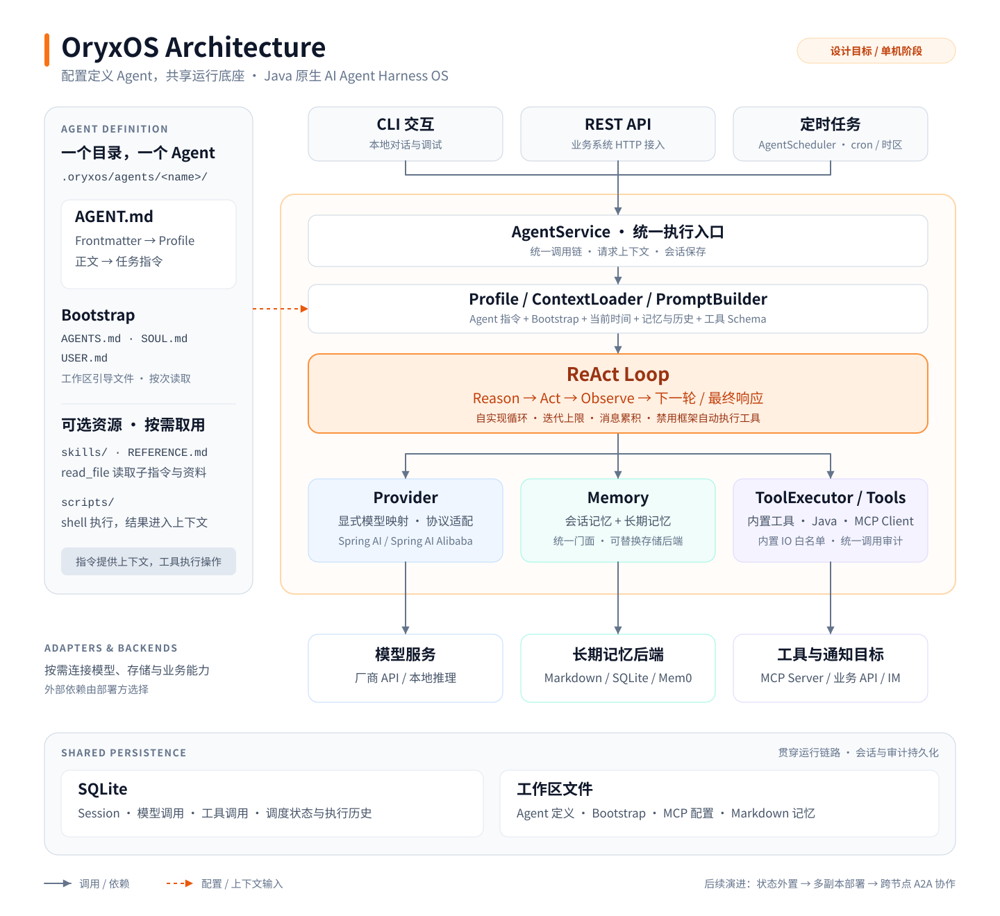

<p align="center">
  
</p>

**Java 原生、可私有部署的 AI Agent Harness OS。**

一份配置定义一个 Agent，一个底座运行和管理一群 Agent。

[项目介绍](docs/oryxos.md) · [技术方案](docs/TechnicalSolution.md) · [需求文档](docs/DemandAnalysis.md) · [参与贡献](#参与贡献)

> **项目状态：工程骨架已建立。** 九个 Maven 模块和最小 Spring Boot 启动入口已就绪，可编译、测试并打包为可执行 JAR。Agent 运行、CLI 子命令与业务 API 尚未实现，下文核心能力仍为设计目标；分布式部署和跨节点协作属于后续路线图。

## 简介

OryxOS 面向希望在自己的基础设施上运行 AI Agent 的团队，提供统一的模型接入、推理循环、上下文、记忆、工具执行和审计能力。业务方通过配置与指令定义 Agent，通过工具接入业务系统，共用一套运行底座。

**Agent Harness** 是模型外的运行骨架：它驱动模型思考、调用工具、观察结果，管理每次调用的上下文，并约束和记录执行行为。**Agent Harness OS** 在这个内核之上管理多个 Agent 的生命周期和共享服务，逐步发展到多节点运行与协作。

OryxOS 以 Java 和 Spring 生态为基础，目标以一个可执行 JAR 部署在企业自己的服务器、虚拟机或 Kubernetes 环境中。底层模型协议适配复用成熟组件，核心执行循环由 OryxOS 自己掌控。

## 为什么选择这个方向

- **复用 Java 工程体系**：沿用团队已有的 Spring 应用开发、部署和运维方式，支持原生 Java 工具扩展。
- **统一 Agent 基础设施**：模型、工具、记忆、会话和审计由底座提供，减少每个业务 Agent 的重复建设。
- **掌控部署与数据访问**：由使用方选择存储位置、模型服务和外部工具，支持面向私有环境的部署设计。
- **通过开放协议扩展**：用 MCP 接入工具，远期通过 A2A 对接跨节点 Agent 协作。
- **先跑通完整链路**：先建设单机内核，再依据实际使用需求推进高可用、治理和分布式能力。

OryxOS 专注 Agent 运行和管理。业务流程由 Agent 根据指令与工具动态执行；需要显式工作流时，外部编排系统可通过 REST API 接入。

## 核心能力

以下五项构成首阶段运行时内核的设计范围：

| 能力 | 设计内容 |
| --- | --- |
| **模型接入 · Provider** | 统一模型调用接口，以 Provider 名显式选择模型实例，支持不同厂商及本地推理服务的适配 |
| **推理循环 · ReAct** | 自实现 Reason → Act → Observe 循环，管理工具调用、结果回填、消息历史和最大迭代次数 |
| **记忆 · Memory** | 会话记忆与长期记忆统一访问；默认使用 Markdown 长期记忆，设计可切换 SQLite 或自托管 Mem0 后端 |
| **工具 · Tool** | 文件、Shell、HTTP、记忆、通知等内置工具；通过 MCP 或 Java `@Tool` 扩展，统一执行与审计 |
| **对外服务 · Web Service** | REST API 提供会话管理、Agent 调用、资源查询及健康检查，供不同语言的业务系统集成 |

配套能力包括多个 Agent 同实例运行、CLI 交互、cron 定时触发、工作区管理、工具白名单，以及 Session、模型调用和工具调用的持久化。

## 架构

下面展示单机阶段的目标架构。CLI、HTTP 和定时任务共用同一个执行入口，业务 Agent 由工作区目录定义。



核心设计约束：

- **执行权归 OryxOS**：Spring AI 提供模型协议适配和工具 Schema 生成，自动工具执行关闭，由 ReAct 与工具执行器统一调度。
- **配置与引擎分离**：Agent 指令进入上下文，工具承担实际操作，底座不解析业务流程步骤。
- **审计进入核心链路**：模型和工具调用写入结构化存储，为后续查询和治理保留数据基础。
- **接口支持演进**：模型、记忆、工具和沙箱通过明确的接口接入，逐步扩展实现。

详细设计见 [技术方案](docs/TechnicalSolution.md)。

## 如何定义一个 Agent

设计采用 **一个目录 = 一个 Agent** 的组织方式：

```text
.oryxos/
└── agents/
    └── daily-tech-digest/
        ├── AGENT.md             # YAML frontmatter：运行配置；正文：任务指令
        ├── REFERENCE.md         # 可选的参考资料
        ├── skills/
        │   └── digest-format.md # 可选的子指令
        └── scripts/
            └── fetch_news.py    # 可选的脚本
```

运行时从 `AGENT.md` 派生 Profile，将正文加入 system prompt。子指令和参考资料按需通过文件工具读取，脚本通过 Shell 工具执行。业务方可以只编写指令并复用现成 MCP Server，也可以用任意语言提供 MCP 工具，或用 Java Bean 深度接入已有服务。

首阶段计划用三个场景验证完整链路：

| 场景 | Agent 行为 | 验证重点 |
| --- | --- | --- |
| 每日天气 | 定时查天气，生成穿搭建议并推送 | 模型调用、ReAct、HTTP、通知与审计 |
| 每日科技日报 | 按用户偏好汇总新闻，读取组稿规范并推送 | 长期记忆、按需加载子指令、可选 MCP 接入 |
| 每日 GitHub 日报 | 执行捆绑脚本采集项目数据，整理摘要并推送 | 脚本执行、工具结果回填与定时链路 |

同一个 Agent 应能通过 CLI、REST API 或定时任务触发，复用相同的执行逻辑。

## 构建与运行

需要 **JDK 21 或更新的受支持 JDK**，推荐使用 JDK 21。`JAVA_HOME` 应指向 JDK 安装目录，`java -version` 与 `./mvnw -version` 均应显示正确的 Java 版本。

仓库附带 Maven Wrapper，固定 Maven **3.9.16**，无需预先安装 Maven；首次运行需要联网下载 Maven 和依赖。Spring Boot 固定为 **3.5.16**，Java 编译目标为 21。

```bash
# 检查构建环境
./mvnw -version

# 在仓库根目录编译、执行测试并打包全部九个模块
./mvnw clean package

# 运行独立 CLI，打印版本后退出（OryxOS 1.0.0-SNAPSHOT）
java -jar oryxos-cli/target/oryxos-cli-1.0.0-SNAPSHOT.jar

# 启动可执行 JAR（默认端口 8080，Ctrl-C 退出）
java -jar oryxos-boot/target/oryxos-boot-1.0.0-SNAPSHOT.jar

# 使用其他端口
java -jar oryxos-boot/target/oryxos-boot-1.0.0-SNAPSHOT.jar --server.port=8081
```

Windows 使用 `mvnw.cmd clean package`；已有 Maven 3.6.3+ 的环境也可执行 `mvn clean package`。

目前启动的是最小应用骨架：内嵌 HTTP 服务可启动，但尚无业务端点或管理页面，访问 `/`、`/api/v1` 或 `/admin/` 返回 404 属于预期。启动不需要模型凭证或数据库配置。

CLI 的独立入口为 `io.github.oryxlabs.oryxos.cli.OryxOsCli.main`，当前只打印版本，不启动 Spring 或 HTTP 服务。版本由 Maven 构建时从项目版本注入，无需在 Java 代码中重复维护。也可以在 IDE 中运行该 main 方法，需先通过 Maven 处理资源文件。

## 工程结构

```text
OryxOS/
├── pom.xml                  # 父 POM：模块聚合、版本与构建约束
├── mvnw / mvnw.cmd          # Maven Wrapper
├── oryxos-core/             # 核心模型、契约与运行时
├── oryxos-provider/         # 模型适配
├── oryxos-memory/           # 记忆门面与后端
├── oryxos-tool/             # 工具、MCP 与沙箱
├── oryxos-channel-cli/      # CLI 输入输出适配
├── oryxos-web/              # REST 接入
├── oryxos-storage/          # 持久化实现
├── oryxos-cli/              # 命令行入口
├── oryxos-boot/             # Spring Boot 装配与可执行 JAR
└── docs/                    # 项目文档与架构图
```

各能力模块依赖 `oryxos-core`，`oryxos-cli` 还依赖 `oryxos-channel-cli`；`oryxos-boot` 聚合其余八个模块。当前只接入启动和 Web 基础依赖，模型、数据库、MCP 与 Picocli 等依赖将在对应能力实现时加入。

## 开始了解项目

### 项目网站

`website/` 提供中英文首页和入门文档，沿用 mq9 网站的布局与视觉风格，内容对应 OryxOS 的定位、架构和当前实现状态。

使用 Node.js 22 或更新版本，在仓库根目录运行：

```bash
npm ci
npm run docs:dev

# 生成静态网站；产物位于 website/.vitepress/dist
npm run docs:build
```

本地默认访问 [http://127.0.0.1:5173/OryxOS/](http://127.0.0.1:5173/OryxOS/)，中文页面位于 `/OryxOS/zh/`。

GitHub Pages 发布目标为 [jianghr-rr.github.io/OryxOS](https://jianghr-rr.github.io/OryxOS/)，无需购买域名。首次发布前，在仓库 **Settings → Pages → Build and deployment → Source** 选择 **GitHub Actions**，Custom domain 留空。相关文件推送到 `main` 后，附带的工作流会构建并发布；也可手动运行 **Deploy website to GitHub Pages**。地址是否可访问取决于工作流是否成功完成，配置文件本身不代表已经上线。

网站结构与维护说明见 [website/README.md](website/README.md)。

### 设计文档

建议从以下材料开始：

1. 阅读 [项目介绍](docs/oryxos.md)，了解定位与范围。
2. 阅读 [需求文档](docs/DemandAnalysis.md) 和 [技术方案](docs/TechnicalSolution.md)，了解能力、模块与验收场景。
3. 准备参与开发时，阅读 [开发指南](CLAUDE.md) 与 [AI 编程指南](docs/AiProgrammingGuide.md)。

未来 CLI 的使用入口如下，**这些是设计中的命令示意，当前仓库尚不能执行**：

```bash
oryxos init                          # 初始化工作区
oryxos profile create my-agent       # 创建 Agent 目录与模板
oryxos chat --profile my-agent       # 与指定 Agent 对话
oryxos serve --port 8080             # 启动 REST API 服务
```

完整命令设计见 [CLI 使用文档](docs/CliGuide.md)。其中部分表述来自历史开发记录，应结合当前仓库状态阅读；当前实际可用的构建和启动方式见上文。

## 路线图

| 阶段 | 目标 | 主要内容 |
| --- | --- | --- |
| **阶段一：单机内核（当前建设方向）** | 在一个实例中运行和管理多个 Agent | 五大核心能力、Agent 目录、CLI/REST、MCP、记忆、基础沙箱、审计写入与定时任务 |
| **阶段二：底座分布式（规划）** | 提升容量与可用性 | 状态外置、多副本部署、调度协调、故障恢复与水平扩展 |
| **阶段三：跨节点协作（愿景）** | 让不同节点的 Agent 协同工作 | Agent 通信底座、A2A 接入、发现、任务委托与可靠异步协作 |

多租户、SSO、工具策略、完整审计查询、可观测性和 Web 管理能力将随各阶段逐步补齐。实现顺序以完整场景和实际需求为依据。

## 安全与部署边界

首阶段设计使用应用层文件、命令和 HTTP 白名单，配合执行超时及审计。它不提供容器或虚拟机级隔离；被允许的脚本可以自行访问网络，因此运行带脚本的 Agent 需要信任其来源。

首阶段 REST 以受控内网为使用前提，认证、多租户和更强隔离列入后续建设。密钥不应写入 Agent 指令或提交到仓库。

私有部署允许使用方掌控数据位置与访问范围；若配置外部模型 API、MCP Server 或通知渠道，相关请求仍会发送到指定服务。需要数据完全留在内网时，应选择相应的本地或私有服务。

## 文档

| 文档 | 内容 |
| --- | --- |
| [项目介绍](docs/oryxos.md) | 产品定位、愿景和设计原则 |
| [需求文档](docs/DemandAnalysis.md) | 功能范围、非功能目标和验收要求 |
| [技术方案](docs/TechnicalSolution.md) | 架构、模块、数据存储和关键流程 |
| [CLI 使用文档](docs/CliGuide.md) | 命令设计、工作区和配置说明 |
| [AI 编程指南](docs/AiProgrammingGuide.md) | Spec-Kit 开发流程与 user story 拆解 |
| [开发指南](CLAUDE.md) | 仓库约定、实现约束和已识别的文档差异 |
| [行业调研](docs/IndustryResearch.md) | 项目背景及生态分析 |
| [oryx-labs 社区](docs/oryx-labs.md) | 社区理念与参与方式 |

## 参与贡献

OryxOS 由 **oryx-labs** 发起，以 AI coding 推进工程建设。欢迎参与设计讨论、澄清需求、完善文档、实现模块、补充测试或提供真实使用场景。

提交贡献时建议：

1. 通过 Issue 描述问题或提案，较大的架构变更先讨论范围与接口。
2. 阅读相关设计和 [开发指南](CLAUDE.md)，使改动符合当前阶段目标。
3. 提交聚焦单一问题的 Pull Request，说明改动原因、验证方式和结果；涉及行为或配置变更时同步文档。

主体开发计划按 Provider → ReAct → Memory / Tool → Web Service 的依赖顺序推进。小范围修复与文档改进可直接参与。

## 许可证

项目计划采用 **Apache License 2.0**。当前仓库尚未添加 `LICENSE` 文件，正式许可文本将在发布前补齐。
