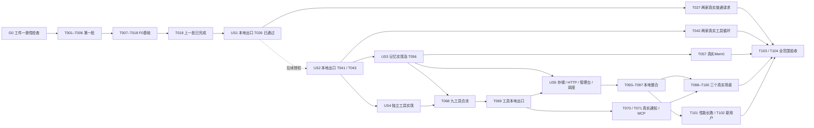

# Tasks: OryxOS 单机 Agent 运行内核

**生成日期**：2026-11-12（任务生成日期，不是宪章批准日期）。  
**功能目录**：`/Users/jianghaoran/github/OryxOS/specs/001-single-node-agent-runtime`。  
**状态**：完整104项任务；88项完成、16项未完成，US5已完成T073–T097及T102（[新使用者上手证据](evidence/US5-onboarding.md)）。第九批继续推进 Slice 5–6（消除虚拟线程 `synchronized` 钉死、跨轮热会话缓存、现有会话内联 `begin` 合并、`wal_autocheckpoint=0` + 安静期 `PASSIVE/RESTART` 检查点、连接池预热及 3GB ZGC），并按用户确认将压测目标时长调整为 2 分钟（`load-profile.json` / `SoakHarness` 已改为 `120s` / `PT2M`，`<=50ms`、100 会话与完整 SQLite 审计未放宽）。最新全量本地 `verify`（`322` 项必跑用例）与 2 分钟 `SoakDiagnosticIT` 稳定性/审计全绿（`500/500` 成功、`0` 违例、创建 P99 `4.59ms`），但 `kernel-short-gate` 内部最大仍为 `112.14ms`（`>50ms`），按路线 C 止损保持 `T101` 未勾选、未启动 `kernel-soak`；见[Slice 5–6 排查与止损证据](evidence/US5-ninth-batch-slice6-review.md)。T098–T100 等真实联调缺口不变，T103–T104 待前置关闭后进入，不提交或推送。

**依据**：[项目宪章](../../.specify/memory/constitution.md)、[spec.md](spec.md)、[plan.md](plan.md)、[research.md](research.md)、[data-model.md](data-model.md)、[runtime 契约](contracts/runtime.md)、[configuration 契约](contracts/configuration.md)、[HTTP 契约](contracts/http-api.json)、[CLI/管理台契约](contracts/cli-admin.md)、[verification.md](verification.md)、[quickstart.md](quickstart.md)。宪章确认按 spec AS-01 和 [CLAUDE.md](../../CLAUDE.md) 已记录结论处理。

## 范围、批次与使用规则

五个用户故事都必须交付，编号表示实施顺序。以下采用 Spec Kit 的 Setup → Foundational → 用户故事 → 收尾结构；不重新初始化项目。现有九模块、Boot 启动主类、CLI Maven 版本资源和版本输出属于复用/待调整基础，所有业务能力仍须新增并验收。

**本轮授权 US5 第九批继续：仅定位提交与写队列、先测试修复，短程达标后再完整四小时复测。** 先测试，固定10 Agent/100独立活跃会话/连续4小时，正式SQLite完整审计与可控外部延迟；未达全部条件不勾选。沿用tools/dev，保留已有改动与真实联调缺口，不进入T102及后续，不提交或推送。

| 阶段 | 任务范围 | 数量 |
| --- | --- | ---: |
| F0-A 第一批工程准备 | T001–T006 | 6 |
| F0-B 配置与装配基础 | T007–T018 | 12 |
| US-1 Provider | T019–T028 | 10 |
| US-2 ReAct | T029–T044 | 16 |
| US-3 Memory | T045–T058 | 14 |
| US-4 Tool | T059–T072 | 14 |
| US-5 Web Service 与整合 | T073–T102 | 30 |
| US-5 跨故事收尾 | T103–T104 | 2 |
| **合计** | **F0 共 18；US5 含收尾共 32** | **104** |

**实施前门禁 G0**：本次任务生成后重新运行 `speckit-analyze`；此前I1/U1/I2修订保留为历史。修复已授权的文档遗漏后复查，确认无F0阻碍才调用 `speckit-implement`。文档检查不代替行为验证。

**路径约定**：所有任务中的文件路径均相对于 `/Users/jianghaoran/github/OryxOS`。文件名为明确的实施落点；尚不存在的文件和 evidence 报告都是未来产物。不得改动官方实验仓库 `/Users/jianghaoran/jikeshijian/oryxos`、课程 run.sh、全局 Java/Node/Maven 或 ACSP 配置。

**格式与完成规则**：

- `Tnnn` 全局唯一；所属阶段写在每项描述中，故事任务另带 `[USn]`。
- `[P]` 表示前置任务完成后，可与下文指定的无文件冲突任务并行；不表示跳过依赖或自动启动多个代理。未标记任务按依赖串行。
- 每项给出文件、前置、依据和可检查完成条件。原文约束摘自 data-model.md；字段、枚举和不可变条件不能留到实现时随意选择。
- verification.md 明确要求行为验证，因此包含测试任务。先建立可运行的契约夹具与预期失败，再接入实现；T006的入口断言在T004之前准备，T016的配置/工作区断言在T008–T012之前准备，T017的存储/降级断言在T013–T015之前准备；这些验证任务的前置是最终验收和勾选条件，不禁止预先准备测试。仅编译失败、空测试集、被跳过用例均不算验收。
- 测试类首次加入时按 [测试执行契约](verification.md#测试执行契约) 声明标签和用例标识；表中指定的登记/出口任务串行维护 `tools/dev/test-groups.json` 中的模块、完整类名与必跑用例，并核对本次实际报告。未来未实现的分组不提前启用，未知/尚未启用组请求明确失败；真实类统一带 `real-integration` 及专用标签，性能类带 `kernel-soak`，普通命令不运行它们。
- 本地出口与最终验收分开：缺凭证可继续不依赖它的本地任务；真实联调任务和依赖其验收的收尾任务必须保持未勾选。
- 所有证据报告记录 FR/SC/场景编号、工作区、版本、命令、输入、预期与实际、执行 ID、副作用次数、结论和未验证原因；秘密与敏感 URL 必须脱敏。
- 不自动暂存、提交、推送；既有未提交改动必须保留。F0完成不代表任何业务故事已完成。

## Phase 1 — F0-A 工程起点（第一批，6 项）

**目标**：能用个人入口隔离构建，保留并验证已有 Boot 与薄 CLI 入口。

**独立验证**：从其他目录调用个人构建脚本；无凭证运行帮助/版本及 Boot 启动测试；核对 `f0-discovery` 的 Test/IT 类均实际执行且缺报告会失败；九模块构建成功，全局环境和 ACSP 配置不变。

- [X] T001 F0-A｜新增个人项目隔离 Maven 构建入口。文件：`tools/dev/mvnw`、`tools/dev/common.sh`、`tools/dev/build.py`、`tools/dev/maven-settings.xml`、`tools/dev/maven-global-settings.xml`、`tools/dev/README.md`、`.gitignore`。

  **前置**：无任务前置；开始实现前须通过 G0；**依据**：宪章VII、FR-041、quickstart §1。

  **完成条件**：只调用本仓库现有mvnw；从ORYXOS_JAVA_HOME选择并核验JDK21，以子进程环境设置Java；独立wrapper缓存、本地仓库及-s/-gs设置；从任意cwd运行显示真实仓库/JDK，缺JDK明确报错。不安装工具、不改全局Java/Node/Maven、不调用课程run.sh。

- [X] T002 F0-A｜复用父/子 POM，按研究结论增加依赖管理及模块依赖。文件：`pom.xml`、`oryxos-core/pom.xml`、`oryxos-provider/pom.xml`、`oryxos-memory/pom.xml`、`oryxos-tool/pom.xml`、`oryxos-channel-cli/pom.xml`、`oryxos-web/pom.xml`、`oryxos-storage/pom.xml`、`oryxos-cli/pom.xml`、`oryxos-boot/pom.xml`。

  **前置**：T001；**依据**：宪章III、plan 骨架审查、research R01。

  **完成条件**：保留九模块、Boot3.5.16和release21；引入AI1.1.8、MCP0.18.3、Picocli4.7.7、SQLite3.51.3.0、validator1.5.9、springdoc2.9.1，Hibernate两件同为Boot管理的6.6.53.Final；starter按模块归属。不引入Boot4/Jackson3/Agent框架；记录effective-pom和依赖树，确认无cli→boot或memory→storage依赖环。

- [X] T003 F0-A｜新增隔离测试分组和可控外部服务夹具基础。文件：`pom.xml`、`oryxos-boot/src/test/java/io/github/oryxlabs/oryxos/boot/support/LocalHttpFixture.java`、`oryxos-boot/src/test/resources/application-test.yaml`、`tools/dev/mvnw`、`tools/dev/test-groups.json`、`tools/dev/check-test-reports.py`、`tools/dev/test_report_gate.py`、`oryxos-boot/src/test/java/io/github/oryxlabs/oryxos/boot/TestDiscoveryIT.java`、`oryxos-boot/src/test/java/io/github/oryxlabs/oryxos/boot/DiscoverySuffixIT.java`。

  **前置**：T002；**依据**：宪章VI、SC-001、verification L1/L2。

  **完成条件**：使用Boot管理JUnit/Mockito/MockMvc；Surefire在test阶段显式包含Test*.java、*Test.java、*Tests.java、*TestCase.java及*IT.java，verify沿用同一执行，不另用Failsafe重复运行。新增轻量TestDiscoveryIT与分组报告核查器，按verification的测试执行契约维护清单：首次只启用f0-discovery，其余组随相应任务登记。默认local模式禁公网并排除real-integration/kernel-soak；显式real/soak模式仍必须选择对应groups。个人mvnw在成功的test/verify后核对本次XML报告：必跑类/用例缺失、全跳过、使用旧报告或未知分组均非零退出；允许不承担该组的模块零测试。所有工作区临时化、端口随机；真实前提缺失记未验证且不得成功退出。核查器仅依赖Python3标准库，不新增全局安装。

- [X] T004 F0-A｜保留薄 CLI 版本入口，新增完整发行的帮助/版本解析。文件：`oryxos-cli/src/main/java/io/github/oryxlabs/oryxos/cli/OryxOsCli.java`、`oryxos-cli/src/main/java/io/github/oryxlabs/oryxos/cli/OryxCommandLine.java`、`oryxos-cli/src/main/resources/io/github/oryxlabs/oryxos/cli/version.properties`。

  **前置**：T002；**依据**：FR-030、plan 骨架审查、contracts/cli-admin §启动。

  **完成条件**：薄JAR无参数/--version仍只用JDK读取Maven版本资源；Picocli放独立解析器供Boot调用。--help/--version不启动Spring、不监听端口、不读密钥、不启动MCP；未完成业务命令明确不可用而非假成功。

- [X] T005 F0-A｜调整现有 Boot 启动分发并新增个人运行入口。文件：`oryxos-boot/src/main/java/io/github/oryxlabs/oryxos/boot/OryxOsApplication.java`、`oryxos-boot/src/main/resources/application.yml`、`tools/dev/oryxos`。

  **前置**：T001、T004；**依据**：FR-030、FR-041、plan 骨架审查。

  **完成条件**：保留Boot主类、扫描根、无参数HTTP启动、8080及虚拟线程；完整发行先解析帮助/版本再决定启动Spring。默认回环监听；新JPA依赖不通过自动扫描提前创建数据源/仓库，受控装配留给F0-B。运行脚本同一JDK、固定个人JAR路径，薄CLI仍能独立打印版本。

- [X] T006 F0-A｜验证第一批工程增量并记录边界。文件：`oryxos-boot/src/test/java/io/github/oryxlabs/oryxos/boot/EntryPointContractTest.java`、`oryxos-boot/src/test/java/io/github/oryxlabs/oryxos/boot/OryxOsApplicationTest.java`、`specs/001-single-node-agent-runtime/evidence/F0-first-batch.md`、`tools/dev/test-groups.json`。

  **前置**：T003、T005；**依据**：宪章VI/VII、FR-030、FR-041。

  **完成条件**：隔离执行clean verify；复核九模块依赖树、Boot随机端口启动、完整JAR帮助/版本、薄CLI版本。将EntryPointContractTest、TestDiscoveryIT和仅匹配*IT的DiscoverySuffixIT登记为f0-discovery必跑类，显式运行该组证明两种命名都被发现；用隔离报告样本验证漏掉IT、全跳过及旧报告均被核查器拒绝。无凭证轻命令零模型/MCP/监听；错误JDK和异地cwd用例通过，全局设置及官方仓库跟踪文件前后哈希不变；最终发行验证前后ACSP构建配置哈希不变，整个实现不操作ACSP。报告明确Agent/API业务未实现；完成后记录F0-A证据，继续本轮已授权F0-B，不进入US1。

**阶段检查点**：T006通过后继续F0-B；此时没有Agent对话、工具、记忆或业务API。

## Phase 2 — F0-B 配置与装配基础（12 项）

**目标**：建立可扩展的工作区、配置、错误、锁及受控 SQLite/JPA 生命周期。

**独立验证**：临时工作区 init 两次不覆盖文件；status 能区分未运行/配置错误；真实 SQLite 初始化与 JPA 故障注入可重复；帮助/版本始终保持轻量。

- [X] T007 [P] F0-B｜独立维护过时文档状态说明。文件：`CLAUDE.md`、`.specify/memory/constitution.md`、`specs/001-single-node-agent-runtime/spec.md`、`specs/001-single-node-agent-runtime/plan.md`。质量清单 `specs/001-single-node-agent-runtime/checklists/requirements.md` 仅只读核对，不修改文件或勾选。

  **前置**：T006；**依据**：宪章VII、AS-01、用户要求7。

  **完成条件**：仅同步已生成tasks/已确认宪章等阶段状态，消除尚无tasks、尚未plan等过时描述；按AS-01保留确认效力。批准日期无可核实证据则明确未登记，不猜日期、不改原则/范围/验收、不重复产品问答。

- [X] T008 [P] F0-B｜新增统一错误与秘密脱敏基础。文件：`oryxos-core/src/main/java/io/github/oryxlabs/oryxos/core/error/OryxError.java`、`oryxos-core/src/main/java/io/github/oryxlabs/oryxos/core/security/SecretResolver.java`、`oryxos-core/src/main/java/io/github/oryxlabs/oryxos/core/security/Redactor.java`。

  **前置**：T006；**依据**：FR-005、FR-028、FR-029。

  **完成条件**：提供稳定错误码和安全说明；秘密仅${NAME}显式引用，环境优先受控本地文件、缺失报错、不递归/执行表达式。使用CANARY检查错误、URL、参数、stderr投影不泄漏；此时无模型/工具执行。

- [X] T009 F0-B｜新增统一工作区定位与幂等初始化。文件：`oryxos-core/src/main/java/io/github/oryxlabs/oryxos/core/workspace/WorkspaceHandle.java`、`oryxos-core/src/main/java/io/github/oryxlabs/oryxos/core/workspace/WorkspaceResolver.java`、`oryxos-core/src/main/java/io/github/oryxlabs/oryxos/core/workspace/WorkspaceInitializer.java`、`oryxos-cli/src/main/resources/templates/runtime.yaml`、`oryxos-cli/src/main/resources/templates/AGENT.md`、`oryxos-cli/src/main/resources/templates/AGENTS.md`、`oryxos-cli/src/main/resources/templates/SOUL.md`、`oryxos-cli/src/main/resources/templates/USER.md`。

  **前置**：T008；**依据**：FR-001、FR-018、FR-030。

  **完成条件**：所有入口同一--root > -Doryxos.root > ORYXOS_ROOT > cwd/.oryxos；规范化根、固定root/oryxos.db。生成稳定workspace.json UUID及缺失模板；第二次init逐文件哈希不变，绝不覆盖已有文件或秘密。

  **原文约束**：「UUID 初始化后稳定；根路径转绝对规范路径」 「Workspace：工作区根目录及 workspace.json；runtime.yaml中的timezone：UUID 初始化后稳定；根路径转绝对规范路径；统一业务时区默认Asia/Shanghai」

- [X] T010 F0-B｜新增运行配置安全读取、作用域错误与统一时区。文件：`oryxos-core/src/main/java/io/github/oryxlabs/oryxos/core/config/RuntimeConfig.java`、`oryxos-core/src/main/java/io/github/oryxlabs/oryxos/core/config/RuntimeConfigLoader.java`、`oryxos-core/src/main/java/io/github/oryxlabs/oryxos/core/config/ProviderDefinition.java`、`oryxos-core/src/main/java/io/github/oryxlabs/oryxos/core/config/ConfigDiagnostics.java`、`oryxos-core/src/main/java/io/github/oryxlabs/oryxos/core/config/SafeYaml.java`。

  **前置**：T009；**依据**：FR-002、FR-003、FR-005、FR-028、RV-04、RV-06、US5-A8。

  **完成条件**：runtime.yaml权威，普通env变量不偷偷覆盖；安全YAML拒绝重复键/tag、限制1MiB/深度64及alias。工作区timezone默认Asia/Shanghai；Provider地址/选项/秘密错误局部隔离，整体语法/重名才CONFIGURATION_ERROR；启动不探测真实账号。

  **原文约束**：「同名Provider冲突使全局配置无效；单个Agent解析／引用失败仅将其标为UNAVAILABLE。」

- [X] T011 F0-B｜新增启动、时钟、执行许可和工作区锁的基础契约。文件：`oryxos-core/src/main/java/io/github/oryxlabs/oryxos/core/runtime/RuntimeLauncher.java`、`oryxos-core/src/main/java/io/github/oryxlabs/oryxos/core/runtime/LaunchMode.java`、`oryxos-core/src/main/java/io/github/oryxlabs/oryxos/core/runtime/RuntimeGate.java`、`oryxos-core/src/main/java/io/github/oryxlabs/oryxos/core/runtime/Deadline.java`、`oryxos-core/src/main/java/io/github/oryxlabs/oryxos/core/runtime/TimeSource.java`、`oryxos-core/src/main/java/io/github/oryxlabs/oryxos/core/workspace/WorkspaceProcessLock.java`。

  **前置**：T009；**依据**：FR-030、FR-033、FR-040。

  **完成条件**：core只用项目/JDK类型；chat/serve/gateway同工作区互斥，轻查询不占运行锁；截止用单调时钟，时区只影响展示及业务日期。许可与关闸可原子配合，执行级/工作区级可分开停止，不靠Thread.interrupt作唯一保证。

  **原文约束**：「deadline计算使用单调时钟；deadlineAt用于展示。」

- [X] T012 F0-B｜新增 init/status 轻命令及根参数统一。文件：`oryxos-cli/src/main/java/io/github/oryxlabs/oryxos/cli/command/InitCommand.java`、`oryxos-cli/src/main/java/io/github/oryxlabs/oryxos/cli/command/StatusCommand.java`、`oryxos-cli/src/main/java/io/github/oryxlabs/oryxos/cli/OryxCommandLine.java`、`oryxos-core/src/main/java/io/github/oryxlabs/oryxos/core/runtime/QueryPort.java`、`oryxos-core/src/main/java/io/github/oryxlabs/oryxos/core/workspace/WorkspaceInspector.java`。

  **前置**：T010、T011、T004；**依据**：FR-001、FR-030、FR-041。

  **完成条件**：init/status无需Spring/模型/MCP；显示规范根、backend、时区、进程与已有故障；未运行/未实现/不可读如实区分。F0仅基础配置诊断，Agent完整可用性由US1补齐，不将模板存在当成可运行。

- [X] T013 F0-B｜新增 SQLite 连接和显式迁移基础。文件：`oryxos-storage/src/main/java/io/github/oryxlabs/oryxos/storage/sqlite/SqliteConnectionFactory.java`、`oryxos-storage/src/main/java/io/github/oryxlabs/oryxos/storage/migration/SchemaMigrator.java`、`oryxos-storage/src/main/resources/db/migration/V001__schema_metadata.sql`。

  **前置**：T002、T009、T011；**依据**：FR-018、FR-038、research R04。

  **完成条件**：本地SQLite使用WAL/FULL、foreign_keys=ON、busy_timeout=5000、最多4连接；迁移持锁、短事务、checksum；只创建schema_migrations等基础元数据，业务表后续新增；ddl-auto=none、禁OSIV/L2缓存，不删库恢复。

  **原文约束**：「version PK；校验和不符停止执行」 「schema_migrations：version,checksum,applied_at：version PK；校验和不符停止执行」

- [X] T014 F0-B｜新增受控存储资源生命周期。文件：`oryxos-storage/src/main/java/io/github/oryxlabs/oryxos/storage/lifecycle/StorageResourceFactory.java`、`oryxos-storage/src/main/java/io/github/oryxlabs/oryxos/storage/lifecycle/StorageResources.java`、`oryxos-boot/src/main/java/io/github/oryxlabs/oryxos/boot/config/StorageLifecycle.java`、`oryxos-core/src/main/java/io/github/oryxlabs/oryxos/core/runtime/StorageAvailability.java`。

  **前置**：T013、T008；**依据**：FR-040、plan F0集成风险。

  **完成条件**：迁移后受控创建JPA工厂/仓库，禁止自动扫描让整个Boot随DB故障退出；创建失败保留诊断与Unavailable状态。关闸下可关闭并重建资源、无旧EntityManager泄漏；此任务只验证资源生命周期，人工恢复业务留US5。

- [X] T015 F0-B｜新增启动模式装配与临时工作区诊断。文件：`oryxos-boot/src/main/java/io/github/oryxlabs/oryxos/boot/runtime/BootRuntimeLauncher.java`、`oryxos-boot/src/main/java/io/github/oryxlabs/oryxos/boot/config/RuntimeConfiguration.java`、`oryxos-boot/src/main/java/io/github/oryxlabs/oryxos/boot/OryxOsApplication.java`、`oryxos-boot/src/main/resources/application.yml`。

  **前置**：T012、T014；**依据**：FR-030、FR-040、宪章III。

  **完成条件**：boot实现core RuntimeLauncher并注入CLI，不产生反向依赖；配置/DB故障仍能启动诊断基础，未就绪不接收业务任务。保持无参数serve；gateway/chat业务在相应US补齐，不伪报已支持；优雅关闭释放资源/锁。

- [X] T016 [P] F0-B｜验证初始化、配置错误隔离与秘密边界。文件：`oryxos-core/src/test/java/io/github/oryxlabs/oryxos/core/config/RuntimeConfigContractTest.java`、`oryxos-cli/src/test/java/io/github/oryxlabs/oryxos/cli/WorkspaceCommandsTest.java`、`oryxos-core/src/test/resources/config/invalid-provider.yaml`。

  **前置**：T012；**依据**：FR-001、FR-003、FR-005、FR-028、RV-04、RV-06。

  **完成条件**：重复init保留哈希；根覆盖优先级一致；局部缺秘密不损坏另一Provider定义，全局坏YAML诊断明确；UTC主机仍加载Asia/Shanghai；CANARY不进入输出。此时只验证配置，不冒充真实Provider调用。

- [X] T017 F0-B｜验证真实 SQLite/JPA 故障装配风险。文件：`oryxos-storage/src/test/java/io/github/oryxlabs/oryxos/storage/StorageLifecycleIntegrationTest.java`、`oryxos-storage/src/test/resources/migration/probe.sql`、`oryxos-boot/src/test/java/io/github/oryxlabs/oryxos/boot/DegradedStartupTest.java`。

  **前置**：T015；**依据**：FR-018、FR-040、verification 存储风险。

  **完成条件**：在临时真实SQLite测迁移checksum、外键、事务、JPA方言与资源关闭；注入不可写/损坏时诊断上下文存活，恢复工厂不继续使用旧连接；无H2替代。探测表仅测试资源，不提前交付会话/审计功能。

- [X] T018 F0-B｜完成 F0 本地出口并记录可操作检查。文件：`oryxos-boot/src/test/java/io/github/oryxlabs/oryxos/boot/OryxOsApplicationTest.java`、`specs/001-single-node-agent-runtime/evidence/F0-foundation.md`、`tools/dev/verify-foundation.py`、`tools/dev/README.md`、`tools/dev/test-groups.json`。

  **前置**：T007、T016、T017；**依据**：宪章VI/VII、FR-001、FR-030、FR-041。

  **完成条件**：全工程隔离verify通过；用户可验证init两次、status根/时区、帮助/版本、启动与第二进程拒绝，DB异常仍可诊断；记录环境、命令、预期/实际及未实现项。尚不能聊天、发通知或使用业务API；US1前核对F0证据。

**阶段检查点**：T018 是进入 US1 的本地基础门禁。T007是本轮授权内的独立文档状态维护，不修改宪章原则或清单勾选。正式会话审计、故障恢复和管理接口仍在 US5。

## Phase 3 — US-1 Provider（核心必交付，10 项）

**目标**：用户通过指定 Provider 获得真实响应或明确失败；模型适配只执行一次协议通信。

**独立验证**：T026 用本地 HTTP 接收器验证五个场景、实际来源、错误隔离与零自动工具执行；T027 分别核对两家真实普通请求。

- [X] T019 [US1] US1｜新增 Provider/Agent 行为契约用例与本地响应夹具。文件：`oryxos-provider/src/test/java/io/github/oryxlabs/oryxos/provider/ProviderContractTest.java`、`oryxos-provider/src/test/resources/responses/tool-reasoning.json`、`oryxos-core/src/test/java/io/github/oryxlabs/oryxos/core/agent/AgentCatalogContractTest.java`、`tools/dev/test-groups.json`。

  **前置**：T018；**依据**：US1-A1、US1-A2、US1-A3、US1-A4、US1-A5、RV-04。

  **完成条件**：先定义普通/工具/空任务/两供应商/401/429/5xx/坏JSON/缺配置用例，HTTP捕获地址、次数与完整消息；以尚缺能力的失败建立基线，不能skip冒充通过；T026接入实际适配器后全部复跑。 先准备契约断言与可运行夹具，确认缺失行为导致预期失败；禁止用编译失败或跳过用例充当验证，阶段出口须全部通过。

- [X] T020 [US1] US1｜新增中立模型消息与单次 Provider 端口。文件：`oryxos-core/src/main/java/io/github/oryxlabs/oryxos/core/model/ChatMessage.java`、`oryxos-core/src/main/java/io/github/oryxlabs/oryxos/core/model/ToolCall.java`、`oryxos-core/src/main/java/io/github/oryxlabs/oryxos/core/provider/ProviderPort.java`、`oryxos-core/src/main/java/io/github/oryxlabs/oryxos/core/provider/ProviderRequest.java`、`oryxos-core/src/main/java/io/github/oryxlabs/oryxos/core/provider/ProviderReply.java`。

  **前置**：T019；**依据**：FR-003、FR-004、FR-008、FR-039。

  **完成条件**：输入包含有序消息/schema/剩余时限，输出保留文本、结构化调用、usage、实际Provider/model；供应商DTO不出provider模块，usage未知非0；为每次调用关联执行ID/iteration。

  **原文约束**：「role取USER、ASSISTANT、TOOL；toolCalls保留每个id/name/argumentsJson。」

- [X] T021 [US1] US1｜新增 Agent 定义派生和局部可用性目录。文件：`oryxos-core/src/main/java/io/github/oryxlabs/oryxos/core/agent/AgentProfile.java`、`oryxos-core/src/main/java/io/github/oryxlabs/oryxos/core/agent/AgentDefinitionReader.java`、`oryxos-core/src/main/java/io/github/oryxlabs/oryxos/core/agent/AgentCatalog.java`、`oryxos-cli/src/main/java/io/github/oryxlabs/oryxos/cli/command/StatusCommand.java`。

  **前置**：T020、T010；**依据**：FR-002、FR-003、FR-005、US1-A2、US1-A3、RV-04、RV-06、US5-A8。

  **完成条件**：一个AGENT.md目录唯一来源；frontmatter/body分离，配置快照与正文哈希分开；工具默认空、通知只名称、cron六字段和时区一致；无效Agent隔离；status接入真实解析状态。名称[a-z0-9][a-z0-9-]{0,63}且等于目录名；max_iterations默认10上限100、max_history_turns默认20正整数。

  **原文约束**：「configRevision 为规范化配置区哈希；正文不在该哈希内，另记 bodyRevision。」 「AgentDefinition：agents/<name>/AGENT.md：name 在工作区唯一且与目录名相等；Profile 是其配置区派生快照」 「启动解析后配置快照不随正文热读改变；每轮仅重新读取正文和Bootstrap。」

- [X] T022 [P] [US1] US1｜新增按名称显式映射的 Provider 注册与请求选项。文件：`oryxos-provider/src/main/java/io/github/oryxlabs/oryxos/provider/ProviderRegistry.java`、`oryxos-provider/src/main/java/io/github/oryxlabs/oryxos/provider/OpenAiClientFactory.java`、`oryxos-provider/src/main/java/io/github/oryxlabs/oryxos/provider/ProviderOptionsMapper.java`。

  **前置**：T021；**依据**：FR-003、FR-004、FR-005、US1-A2、US1-A3、RV-04。

  **完成条件**：每个Provider独立OpenAiApi实例，只有其引用Agent受配置失败影响；单次同步请求，无fallback/隐式重试/自动工具回调。endpoint/path不重复/v1；DeepSeek extraBody顶层、Kimi禁止thinking/temperature并保留reasoning_effort；模型名按配置，不硬编码旧课程。

  **原文约束**：「ProviderDefinition：runtime.yaml：provider name 唯一；Agent引用名称；凭证只保留secret引用」 「单个Provider的地址、选项或凭证错误只使该Provider及引用它的Agent不可用；」 「不能因为同一个runtime.yaml中另一Provider缺凭证就关闭所有有效Agent。」

- [X] T023 [P] [US1] US1｜新增工具名称双向映射与快照类型。文件：`oryxos-provider/src/main/java/io/github/oryxlabs/oryxos/provider/ToolWireNameMapper.java`、`oryxos-core/src/main/java/io/github/oryxlabs/oryxos/core/model/ToolNameMap.java`。

  **前置**：T020；**依据**：FR-008、FR-020、FR-024、US2-A1。

  **完成条件**：合法内置名称原样发送，其余t_+UTF-8 SHA256前48位；启动检测冲突；保存internal/wire及MCP server/remote名，未知wire不猜映射；历史回放原wireName和call id。测试两个server同名工具不会碰撞。

  **原文约束**：「工具调用另保存原始wireName；executions保存tool_name_map_json快照，」 「授权/公开结果用内部全名，模型历史回放用原始wireName，避免MCP点号名称违反模型协议。」

- [X] T024 [US1] US1｜新增低层 Spring AI 单次请求与响应适配。文件：`oryxos-provider/src/main/java/io/github/oryxlabs/oryxos/provider/SpringAiProvider.java`、`oryxos-provider/src/main/java/io/github/oryxlabs/oryxos/provider/ProviderMessageMapper.java`、`oryxos-provider/src/main/java/io/github/oryxlabs/oryxos/provider/ProviderErrorMapper.java`。

  **前置**：T022、T023；**依据**：FR-004、FR-005、FR-008、US1-A1、US1-A4、US1-A5。

  **完成条件**：使用OpenAiApi.chatCompletionEntity及实际record构造器；多轮reasoning_content不丢。模型提出工具时仅返回数据；空白输入调用前拒绝，安全区分认证/限流/连接/协议失败；请求预算传入底层连接/read超时。

  **原文约束**：「providerOpaque是供应商限定的协议续传资料（如reasoning_content），只供相同Provider重放，」 「不可进入公开历史DTO、普通日志、审计摘要或长期记忆。」

- [X] T025 [US1] US1｜新增模型调用结构化日志端口与脱敏投影。文件：`oryxos-core/src/main/java/io/github/oryxlabs/oryxos/core/audit/AuditSink.java`、`oryxos-core/src/main/java/io/github/oryxlabs/oryxos/core/audit/ModelCallRecord.java`、`oryxos-provider/src/main/java/io/github/oryxlabs/oryxos/provider/AuditedProvider.java`、`oryxos-boot/src/main/java/io/github/oryxlabs/oryxos/boot/audit/StructuredLogAuditSink.java`。

  **前置**：T024、T008；**依据**：FR-028、FR-038、FR-039、US1-A1、US1-A4。

  **完成条件**：日志记录真实Provider/model、关联ID、耗时、结果、可得用量；无完整secret/Webhook/opaque；接口可在US5替换持久实现。US1日志不得标成数据库审计；模型调用前后都有可关联证据。

- [X] T026 [US1] US1｜执行无凭证 Provider 本地验收。文件：`oryxos-provider/src/test/java/io/github/oryxlabs/oryxos/provider/ProviderContractTest.java`、`oryxos-provider/src/test/java/io/github/oryxlabs/oryxos/provider/ProviderSmokeTest.java`、`specs/001-single-node-agent-runtime/evidence/US1-local.md`、`tools/dev/test-groups.json`。

  **前置**：T025、T021；**依据**：US1-A1、US1-A2、US1-A3、US1-A4、US1-A5、RV-04、SC-001、SC-002。

  **完成条件**：groups=us1-contract从实际适配器到两个回环服务；验证一方缺密钥另一方仍可调用、工具0次执行、错误矩阵和协议往返；提供可执行独立JUnit演示及来源证据，供US2继续开发。

- [ ] T027 [US1] US1｜安排两家真实模型普通请求联调。文件：`oryxos-provider/src/test/java/io/github/oryxlabs/oryxos/provider/RealProviderIT.java`、`specs/001-single-node-agent-runtime/evidence/US1-real-models.md`、`tools/dev/test-groups.json`。

  **前置**：T026；**依据**：FR-004、US1-A1、US1-A2、US1-A4、SC-002。

  **完成条件**：显式real模式、groups=real-provider运行DeepSeek/Kimi各一普通请求；核对实际model/Provider、响应和脱敏失败信息，记录版本/时间。有效凭证与额度是外部前提；缺任一家保持本任务未勾选，不能用假服务替代，工具多轮由US2另测。

  **拆分（spec 007）**：T027 为父项，下列两个子项都完成才可勾选；T028 前置仍指父项。

  - [X] T027-K Kimi 普通请求：分组 `real-provider-kimi`（`RealKimiProviderIT`），依据 [007 Kimi 真实验收摘要](../007-kimi-provider-onboarding/evidence/kimi-real.md)（runId `8ed7f0ca-a2c5-4821-8d87-017af0c124fb`）。
  - [ ] T027-D DeepSeek 普通请求：分组 `real-provider`（双入口，仍要求两家同时就绪）或后续 DeepSeek 专用分组。

- [ ] T028 [US1] US1｜核对 US1 证据及后续依赖边界。文件：`specs/001-single-node-agent-runtime/evidence/US1-review.md`。

  **前置**：T026、T027；**依据**：宪章VI/VII、SC-001、SC-002。

  **完成条件**：对照spec/plan/tasks与实际实现审查五场景，逐项链接local/real证据；只有真实项完成才关闭US1验收。缺凭证时本任务也未完成，但允许在T026通过后继续独立本地US2工作，最终验收不得放行。

**阶段检查点**：T026 通过即可安排依赖它的 US2 本地开发；T027 未完成时 T028 不能勾选。真实工具回填继续在 T042 验证。

## Phase 4 — US-2 ReAct（核心必交付，16 项）

**目标**：自有循环读取任务上下文、顺序执行获准工具并回填结果；未知副作用和截止后停止新动作。

**独立验证**：T041 以真实 CLI 主入口、测试专用临时会话和可控 Provider 完成多轮天气任务；T043 检查 UNKNOWN 后零新增调用、纠正关联与截止竞争；T042 检查真实模型回填。

- [x] T029 [US2] US2｜新增循环、截止、纠正与未知副作用的契约夹具。文件：`oryxos-core/src/test/java/io/github/oryxlabs/oryxos/core/react/ReActContractTest.java`、`oryxos-core/src/test/resources/react/scripted-turns.json`、`oryxos-core/src/test/java/io/github/oryxlabs/oryxos/core/react/FailurePolicyContractTest.java`。

  **前置**：T026；**依据**：US2-A1、US2-A2、US2-A3、US2-A4、US2-A5、US2-A6、RV-01、RV-06。

  **完成条件**：预置多轮、直答、多个顺序工具、坏参数、未知名、上限、UNKNOWN后模型想重发等脚本；检查真实执行计数和消息配对，保留实现前失败基线，后续T041复跑。 先准备契约断言与可运行夹具，确认缺失行为导致预期失败；禁止用编译失败或跳过用例充当验证，阶段出口须全部通过。

- [x] T030 [US2] US2｜新增执行、工具结果、调用上下文与统一端口。文件：`oryxos-core/src/main/java/io/github/oryxlabs/oryxos/core/execution/Execution.java`、`oryxos-core/src/main/java/io/github/oryxlabs/oryxos/core/execution/ExecutionContext.java`、`oryxos-core/src/main/java/io/github/oryxlabs/oryxos/core/tool/OryxTool.java`、`oryxos-core/src/main/java/io/github/oryxlabs/oryxos/core/tool/ToolResult.java`、`oryxos-core/src/main/java/io/github/oryxlabs/oryxos/core/tool/ToolRegistryPort.java`。

  **前置**：T029；**依据**：FR-006、FR-007、FR-008、FR-027、FR-039。

  **完成条件**：所有主键UUID、UTC展示时间、单调时钟耗时；Execution含deadline/status/stopReason/recordingStatus/inFlightCount/错误标志/timezone；工具结果含SUCCESS/ERROR/DENIED/UNKNOWN/NOT_EXECUTED及NONE/CONFIRMED/UNKNOWN副作用，重试次数独立可查。

  **原文约束**：「recordingStatus取COMPLETE、INCOMPLETE、UNKNOWN；只有所有必须记录提交成功才为COMPLETE。」 「Execution：executions：每次人工／定时触发独立UUID；关联一个Session及可选schedule id」 「RUNNING：正在处理，可在许可内发起下一动作」 「SUCCEEDED：产生最终回复、请求成功或错误已由引擎核实纠正，无未知／未执行请求；不以文本替代外部接收证据」 「PARTIAL：存在未解决的工具错误、未知副作用或未执行步骤；可由引擎直接返回核查说明，无需再请求模型」 「FAILED：致命Provider／上下文错误、迭代上限等导致无法正常完成」 「TIMED_OUT：截止已到，不再发起新动作；在途结果可能稍后补记」 「PARTIAL_RECORDING_FAILURE：动作已发生而会话／审计保存失败；显示部分完成及记录异常」 「INTERRUPTED：重启发现未完成执行；不自动重放，进入人工核对流程」 「deadline计算使用单调时钟；deadlineAt用于展示。manual=60秒，自动定时默认也采用60秒」 「执行预算并允许仅在文件中显式设置更长budget，不能改变人工调用的60秒规则。」

- [x] T031 [US2] US2｜新增统一工具注册、离线参数校验与权限端口。文件：`oryxos-tool/src/main/java/io/github/oryxlabs/oryxos/tool/ToolRegistry.java`、`oryxos-tool/src/main/java/io/github/oryxlabs/oryxos/tool/policy/ToolPolicy.java`、`oryxos-tool/src/main/java/io/github/oryxlabs/oryxos/tool/validation/ToolArgumentValidator.java`、`oryxos-core/src/main/java/io/github/oryxlabs/oryxos/core/tool/ToolDescriptor.java`。

  **前置**：T030、T023；**依据**：FR-019、FR-020、FR-024、US2-A4。

  **完成条件**：内置/后续Memory/原生/MCP共一注册表；Agent工具集合与资源规则双重检查。NetworkNT禁止远程$ref，JSON深度64，schema/参数64KiB；未知/冲突工具拒绝，校验不产生网络IO。

  **原文约束**：「ToolDefinition：内置注册／原生扩展／MCP发现：工具全名唯一；MCP名称带server前缀；Agent只选择子集」

- [x] T032 [US2] US2｜新增唯一工具执行器与尝试审计。文件：`oryxos-core/src/main/java/io/github/oryxlabs/oryxos/core/tool/ToolExecutor.java`、`oryxos-core/src/main/java/io/github/oryxlabs/oryxos/core/audit/ToolCallRecord.java`、`oryxos-boot/src/main/java/io/github/oryxlabs/oryxos/boot/audit/StructuredLogAuditSink.java`。

  **前置**：T031、T025、T011；**依据**：FR-006、FR-008、FR-020、FR-027、FR-038、US2-A3、US2-A4。

  **完成条件**：每次校验→许可→STARTED→实际IO→结果，拒绝也留痕；一次请求只由本入口调用，不用Spring自动callbacks。安全暂时失败至多额外3次退避250/500/1000ms，每次重新检查许可；未知副作用和401/403等不重试。

- [x] T033 [P] [US2] US2｜新增最小受控 HTTP GET 工具。文件：`oryxos-tool/src/main/java/io/github/oryxlabs/oryxos/tool/http/HttpTargetPolicy.java`、`oryxos-tool/src/main/java/io/github/oryxlabs/oryxos/tool/http/HttpGetTool.java`。

  **前置**：T032、T010；**依据**：FR-019、FR-023、US2-A1、US4-A2。

  **完成条件**：精确scheme/host/port与域名标签匹配，拒绝userinfo；每次重定向重新授权最多3跳，读取64KiB有界；connect≤5秒/read不超过配置与剩余deadline。回环固定天气为首个真实工具IO，拒绝目标计数0。

- [x] T034 [P] [US2] US2｜新增会话基础实现、记忆端口及显式早期演示装配。文件：`oryxos-core/src/main/java/io/github/oryxlabs/oryxos/core/session/Session.java`、`oryxos-core/src/main/java/io/github/oryxlabs/oryxos/core/session/SessionStore.java`、`oryxos-core/src/main/java/io/github/oryxlabs/oryxos/core/session/SessionHistoryPort.java`、`oryxos-core/src/main/java/io/github/oryxlabs/oryxos/core/memory/MemoryPort.java`、`oryxos-core/src/main/java/io/github/oryxlabs/oryxos/core/memory/ContextMemory.java`、`oryxos-boot/src/test/java/io/github/oryxlabs/oryxos/boot/support/EarlyRuntimeConfiguration.java`、`oryxos-boot/src/test/java/io/github/oryxlabs/oryxos/boot/support/TransientSessionStore.java`、`oryxos-boot/src/test/java/io/github/oryxlabs/oryxos/boot/support/EmptyMemoryFacade.java`、`oryxos-core/src/main/java/io/github/oryxlabs/oryxos/core/session/SessionManager.java`、`oryxos-core/src/main/java/io/github/oryxlabs/oryxos/core/session/HistorySelector.java`、`oryxos-core/src/test/java/io/github/oryxlabs/oryxos/core/session/SessionRuntimeContractTest.java`。

  **前置**：T030；**依据**：宪章III/V、FR-008、FR-010、FR-011、RV-02。

  **完成条件**：在core定义Session/SessionStore/SessionHistoryPort，并交付可供US2直接调用的SessionManager、HistorySelector最小实现：创建会话时保存完整身份和Provider/model，续聊校验身份及模型快照，提供非排队占用/收尾、消息追加和完整turn读取。max_history_turns默认20且可配置，近期历史排除本次turn；Store只负责存取，不复制身份/历史策略。SessionRuntimeContractTest以临时Store验证这些行为。EarlyRuntimeConfiguration只在测试profile装配真实SessionManager；TransientSessionStore仅替代持久化，EmptyMemoryFacade通过SessionHistoryPort取得近期/本次turn，仅把长期记忆置空。US2演示不依赖尚未实施的T047/T054，测试替身不进入默认生产装配。归档等完整规则由T047完善，跨进程恢复由US5验收。US3的T054完成后，EarlyRuntimeConfiguration已改用正式MemoryService；EmptyMemoryFacade仅保留历史测试源文件，不再装配。

  **原文约束**：「UUID唯一；绑定channel、user_id、agent_name及创建时provider_name/model；三元组不是唯一键，允许多个会话」

- [x] T035 [US2] US2｜新增按次读取的上下文与单次历史注入。文件：`oryxos-core/src/main/java/io/github/oryxlabs/oryxos/core/context/ContextLoader.java`、`oryxos-core/src/main/java/io/github/oryxlabs/oryxos/core/context/PromptBuilder.java`。

  **前置**：T034、T021；**依据**：FR-008、FR-009、FR-011、US2-A6、RV-02、RV-06、US5-A8。

  **完成条件**：每轮重读正文/Bootstrap、提供工作区时区当前时间；只消费一次ContextMemory，近期完整20轮排除本次turn后单独带入本次；参考按需、脚本只消费输出。缺文件/容量不足明确失败，秘密文件不可作为Bootstrap。

- [x] T036 [US2] US2｜新增自有顺序 ReAct 循环。文件：`oryxos-core/src/main/java/io/github/oryxlabs/oryxos/core/react/ReActLoop.java`。

  **前置**：T035、T032、T033；**依据**：FR-006、FR-007、FR-008、US2-A1、US2-A2、US2-A3、US2-A5。

  **完成条件**：按Profile默认10且≤100轮，直答立即结束；assistant工具请求按顺序执行/回填call ID，拒绝/未执行也配对；不得并行工具、不压平历史。迭代耗尽停止新动作并区分已完成/目标未完成。

- [x] T037 [US2] US2｜新增公共 AgentService 编排与执行生命周期。文件：`oryxos-core/src/main/java/io/github/oryxlabs/oryxos/core/agent/AgentService.java`、`oryxos-core/src/main/java/io/github/oryxlabs/oryxos/core/execution/ExecutionStore.java`、`oryxos-core/src/main/java/io/github/oryxlabs/oryxos/core/execution/ProcessRequest.java`、`oryxos-boot/src/test/java/io/github/oryxlabs/oryxos/boot/support/TransientExecutionStore.java`、`oryxos-boot/src/test/java/io/github/oryxlabs/oryxos/boot/support/EarlyRuntimeConfiguration.java`。

  **前置**：T036、T034；**依据**：FR-006、FR-010、FR-011、FR-033、US2-A1。

  **完成条件**：CLI/后续HTTP/调度只调用此端口；建立执行ID/deadline，编排调用T034的SessionManager完成创建/续聊校验、占用、消息追加与收尾，AgentService不直接访问SessionStore、不重复身份/历史策略。ExecutionStore负责执行记录；US2在测试装配中注入TransientExecutionStore及日志AuditSink，补齐可运行依赖。显式ExecutionContext，ThreadLocal如有使用必须finally清理；在途未退出时由同一会话生命周期保持忙碌，不因HTTP超时提前放锁。

- [x] T038 [US2] US2｜落实未知副作用终止和可证明的参数纠正。文件：`oryxos-core/src/main/java/io/github/oryxlabs/oryxos/core/react/ToolFailurePolicy.java`、`oryxos-core/src/main/java/io/github/oryxlabs/oryxos/core/react/CorrectionTracker.java`、`oryxos-core/src/main/java/io/github/oryxlabs/oryxos/core/react/ReActLoop.java`。

  **前置**：T037；**依据**：FR-027、FR-032、US2-A4、US4-A7、RV-01、RV-06。

  **完成条件**：UNKNOWN副作用立即关闭该执行，补NOT_EXECUTED，PARTIAL/SIDE_EFFECT_UNCERTAIN，不再请求模型。仅可解析INVALID_ARGUMENTS且无副作用、单一同名调用、只修正错误字段的受控链可RESOLVED；不改旧ERROR，权限拒绝/无法关联保留PARTIAL；修正成功SUCCEEDED并保留hasToolErrors。

  **原文约束**：「tool invocation保留原失败结果，并增加resolutionStatus、correctionOfCallId、resolvedByCallId。」 「所有错误已解决时可SUCCEEDED，但hasToolErrors=true，显示已纠正错误的提示；」 「仍有未解决错误则hasUnresolvedToolErrors=true并为PARTIAL，不能仅凭模型声称完成改为成功。」 「有副作用动作结果UNKNOWN立即终止本次执行，stopReason=SIDE_EFFECT_UNCERTAIN，」 「补记同轮剩余请求NOT_EXECUTED；未同时超时／记录故障时为PARTIAL。」

- [x] T039 [US2] US2｜落实原子动作许可与迟到结果处理。文件：`oryxos-core/src/main/java/io/github/oryxlabs/oryxos/core/runtime/ActionDispatcher.java`、`oryxos-core/src/main/java/io/github/oryxlabs/oryxos/core/runtime/Deadline.java`、`oryxos-core/src/main/java/io/github/oryxlabs/oryxos/core/agent/AgentService.java`。

  **前置**：T038；**依据**：FR-033、FR-040、SC-011、US5-A2、RV-01。

  **完成条件**：入口即建立60秒deadline；每个外部动作及工具内部子请求在发起边界重新查许可，不能在等待记录提交后越过截止。截止先关许可再返回，迟到只记录不续跑；记录失败工作区暂停优先，不宣称外部动作撤销。

  **原文约束**：「终态不回RUNNING；迟到动作更新其attempt信息，不启动新步骤。」 「已返回的HTTP 504不被迟到响应改成200；查询可显示后续已知动作结果。」 「若超时后再发现保存故障，保留stopReason=DEADLINE并显示记录异常，不能丢失任一事实。」

- [x] T040 [US2] US2｜新增 CLI 对话适配与统一引擎接入。文件：`oryxos-channel-cli/src/main/java/io/github/oryxlabs/oryxos/channel/cli/CliChannelAdapter.java`、`oryxos-cli/src/main/java/io/github/oryxlabs/oryxos/cli/command/ChatCommand.java`、`oryxos-boot/src/main/java/io/github/oryxlabs/oryxos/boot/config/AgentRuntimeConfiguration.java`。

  **前置**：T039、T015；**依据**：FR-030、US2-A1、US3-A2。

  **完成条件**：chat --profile/--user/[--session]、/quit、明确退出码；channel固定cli；输入/忙碌/超时/UNKNOWN可理解，禁止再开第二工作区运行进程。US2测试profile注入早期Store/Memory替身；无正式存储时默认运行明确未就绪。

- [x] T041 [US2] US2｜执行真实 CLI 入口的本地循环集成验证。文件：`oryxos-boot/src/test/java/io/github/oryxlabs/oryxos/boot/EarlyCliLoopIntegrationTest.java`、`oryxos-core/src/test/java/io/github/oryxlabs/oryxos/core/react/ReActContractTest.java`、`specs/001-single-node-agent-runtime/evidence/US2-local.md`、`tools/dev/test-groups.json`。

  **前置**：T040；**依据**：US2-A1、US2-A2、US2-A3、US2-A4、US2-A5、US2-A6、RV-02、SC-001、SC-003。

  **完成条件**：groups=us2-loop驱动CLI入口、假模型和回环天气；使用T034真实SessionManager和T037临时ExecutionStore，核对创建/续聊身份、完整turn仅一次以及次数/顺序/上下文更新/上限/协议配对；不复制SessionManager到测试替身中。参考和脚本先用受控工具夹具，真实脚本在US4/整合补验；证据明确暂无落库审计。

- [ ] T042 [US2] US2｜安排 DeepSeek/Kimi 真实多轮工具回填。文件：`oryxos-boot/src/test/java/io/github/oryxlabs/oryxos/boot/RealProviderToolLoopIT.java`、`specs/001-single-node-agent-runtime/evidence/US2-real-tools.md`、`tools/dev/test-groups.json`。

  **前置**：T041、T027；**依据**：FR-004、US2-A1、SC-002。

  **完成条件**：显式real模式、groups=real-provider-tools，两家各完成至少两轮模型请求加一次已知数据工具；核对实际call id/wire名及reasoning_content回传和工具执行数。真实Provider凭证缺失保持未完成，普通聊天通过不能替代此任务。

  **拆分（spec 007）**：T042 为父项，下列两个子项都完成才可勾选；T044、T098–T100 前置仍指父项。

  - [X] T042-K Kimi 工具回填：分组 `real-provider-tools-kimi`（`RealKimiToolLoopIT`），依据 [007 Kimi 真实验收摘要](../007-kimi-provider-onboarding/evidence/kimi-real.md)，引用 `T027-K` 通过 runId `8ed7f0ca-a2c5-4821-8d87-017af0c124fb`。
  - [ ] T042-D DeepSeek 工具回填：分组 `real-provider-tools`（双入口）或后续 DeepSeek 专用分组。

- [x] T043 [US2] US2｜验证未知结果、纠正与截止竞争的行为边界。文件：`oryxos-core/src/test/java/io/github/oryxlabs/oryxos/core/react/FailurePolicyContractTest.java`、`oryxos-core/src/test/java/io/github/oryxlabs/oryxos/core/runtime/DeadlineRaceTest.java`、`specs/001-single-node-agent-runtime/evidence/RV01-RV06-loop.md`、`tools/dev/test-groups.json`。

  **前置**：T041；**依据**：RV-01、RV-06、US2-A4、US2-A5、US4-A7、US5-A2、SC-011。

  **完成条件**：预设模型后续想重发但实际后续请求0；同轮剩余工具未执行。原失败与纠正链可追溯，变更有效目标/多失败/权限拒绝不能清错；可控时钟下截止边界零新增，真实HTTP60秒留US5另验。

- [ ] T044 [US2] US2｜核对 US2 日志链路与后续并行前提。文件：`specs/001-single-node-agent-runtime/evidence/US2-review.md`。

  **前置**：T041、T043、T042；**依据**：宪章VI/VII、SC-001、SC-002、SC-011。

  **完成条件**：逐项核对六场景、两家真实工具与RV证据。US3/US4实现只依赖T041和T043已通过；真实凭证缺失不能勾选本出口，也不能阻止独立本地工作；保留全部最终验收要求。

**阶段检查点**：T041、T043 通过后，US3 与 US4 的独立部分可分别推进；T044 还要求真实模型证据。早期替身只用于显式测试演示，不能成为正式运行的降级策略。

## Phase 5 — US-3 Memory（核心必交付，14 项）

**目标**：会话历史按入口/用户/Agent 分开；长期记忆按工作区共享；三种后端保留核心原文并支持显式保存。

**独立验证**：T056 验证身份矩阵、完整 turn、单次历史注入、真实 md/SQLite 与可控 Mem0 协议；T057 验证真实 Mem0 语义正反例和持久化。

- [X] T045 [US3] US3｜新增会话身份和三后端共同契约测试。文件：`oryxos-memory/src/test/java/io/github/oryxlabs/oryxos/memory/MemoryContractTest.java`、`oryxos-core/src/test/java/io/github/oryxlabs/oryxos/core/session/SessionContractTest.java`、`oryxos-memory/src/test/resources/memory/semantic-cases.json`、`tools/dev/test-groups.json`。

  **前置**：T041、T043；**依据**：US3-A1、US3-A2、US3-A3、US3-A4、US3-A5、US3-A6、US3-A7、RV-02、RV-03。

  **完成条件**：先定义身份矩阵、共享事实、CORE/ARCHIVAL、并发写后读、未知保存及重启用例；采用端口测试驱动/临时工作区，待各后端接入后复跑。Session持久重启用例最终由US5运行，不能提前勾成已通过。 先准备契约断言与可运行夹具，确认缺失行为导致预期失败；禁止用编译失败或跳过用例充当验证，阶段出口须全部通过。

- [X] T046 [US3] US3｜完善会话快照及长期记忆数据契约。文件：`oryxos-core/src/main/java/io/github/oryxlabs/oryxos/core/session/Session.java`、`oryxos-core/src/main/java/io/github/oryxlabs/oryxos/core/memory/MemoryEntry.java`、`oryxos-core/src/main/java/io/github/oryxlabs/oryxos/core/memory/LongTermMemoryStore.java`、`oryxos-core/src/main/java/io/github/oryxlabs/oryxos/core/memory/MemoryRecordStore.java`、`oryxos-core/src/main/java/io/github/oryxlabs/oryxos/core/memory/WriteReceipt.java`。

  **前置**：T045；**依据**：FR-010、FR-013、FR-014、FR-015、FR-017、FR-018、RV-03。

  **完成条件**：Session创建时保存非空Provider/model且不可改绑，UTC/UUID及身份不混用；MemoryEntry含workspace/scope/source/backend/原文/状态/remoteIds，原文与投影状态分开；共同接口不假设语义检索等同关键词。

  **原文约束**：「provider_name/model创建时非空且不可变；身份组合查询索引；kind=CONVERSATION/ONE_SHOT；status=ACTIVE/ARCHIVED」 「LongTermMemory：所选backend：同工作区共享；记录source Agent用于追踪，不用于隔离或过滤」 「MemoryEntry：id、workspaceId、scope(CORE/ARCHIVAL)、rawContent、createdAt、」 「sourceExecutionId、sourceAgentName、backend、writeStatus、remoteIds。」 「默认scope=ARCHIVAL。CORE始终原文完整；不以字节预算静默删CORE。」

- [X] T047 [US3] US3｜完善既有会话生命周期与历史规则。文件：`oryxos-core/src/main/java/io/github/oryxlabs/oryxos/core/session/SessionManager.java`、`oryxos-core/src/main/java/io/github/oryxlabs/oryxos/core/session/HistorySelector.java`、`oryxos-core/src/main/java/io/github/oryxlabs/oryxos/core/session/SessionHistoryPort.java`。

  **前置**：T046、T034；**依据**：FR-010、FR-011、FR-012、US3-A1、US3-A2、US3-A5、RV-02、RV-03。

  **完成条件**：复用T034已实现的SessionManager/HistorySelector，在同一实现中补齐归档、ONE_SHOT收尾与完整生命周期，不另造第二套会话逻辑；不同channel/user/Agent续聊拒绝，同组合可多会话，空会话同样校验创建模型快照。验证配置覆盖默认20轮、近期完整turn排除本turn且裁剪不删历史；忙碌不排队，归档不可追加，ONE_SHOT待在途收尾结束才归档。T037的编排调用无需迁移职责，正式持久化由US5替换Store。

  **原文约束**：「Session归档只允许无活跃本地执行时发生；忙碌返回409。归档后继续发消息返回409，不能隐式新建。」 「每个用户任务构成一个turn。最近20轮选择完整turn，不按任意20条消息裁剪；」 「assistant提出的每个调用必须有对应TOOL结果，拒绝、未执行、超时也有明确结果状态。」 「ONE_SHOT会话在本地执行及迟到收尾结束后归档，记录仍可查询；不用于下一次invoke。」

- [X] T048 [P] [US3] US3｜新增默认 Markdown 原文记忆后端。文件：`oryxos-memory/src/main/java/io/github/oryxlabs/oryxos/memory/backend/MarkdownMemoryStore.java`、`oryxos-memory/src/main/java/io/github/oryxlabs/oryxos/memory/backend/MemoryTextCodec.java`。

  **前置**：T046；**依据**：FR-013、FR-014、FR-015、FR-016、US3-A3、US3-A4。

  **完成条件**：读写root/memory/MEMORY.md，CORE原文全量，ARCHIVAL默认；Unicode NFC/大小写折叠字面子串只检索归档，空查询拒绝；共享工作区锁、临时文件/fsync/原子替换避免覆盖；损坏文件报错不重建。

  **原文约束**：「归档注入最多4000 Unicode code points，不切断代理对；超限仅影响注入，不删已保存内容。」 「关键词检索为Unicode NFC规范化、大小写折叠后的字面子串，空关键词拒绝；」 「sqlite使用转义LIKE参数或等价匹配，不能让用户%/_变成隐式通配符。」 「工作区级锁、同目录临时文件、fsync后原子替换；发现损坏格式返回错误，不当作空记忆重建。」

- [X] T049 [US3] US3｜新增本地记忆账本和来源映射持久适配。文件：`oryxos-storage/src/main/resources/db/migration/V002__memory_ledger.sql`、`oryxos-storage/src/main/java/io/github/oryxlabs/oryxos/storage/memory/JpaMemoryRecordStore.java`、`oryxos-storage/src/main/java/io/github/oryxlabs/oryxos/storage/memory/MemoryEntryEntity.java`、`oryxos-storage/src/main/java/io/github/oryxlabs/oryxos/storage/memory/RemoteLinkEntity.java`。

  **前置**：T046、T014；**依据**：FR-013、FR-014、FR-017、FR-018。

  **完成条件**：memory_entries按workspace/backend/scope/created_at/id索引；sourceAgent仅追踪不过滤；memory_remote_links复合主键只接受当前工作区已确认来源。原文/状态/远端映射短事务，core MemoryRecordStore端口隔离memory→storage。

  **原文约束**：「writeStatus=PREPARED/CONFIRMED/UNKNOWN/FAILED；两种scope按各自的提交条件确认成功。」 「memory_entries：MemoryEntry的本地字段，raw_content,write_status：(workspace_id,backend,scope,created_at,id)索引；Agent不是隔离键」 「memory_remote_links：source_entry_id,remote_id,workspace_id,verified_at：复合PK；只接受当前工作区已确认映射」

- [X] T050 [P] [US3] US3｜新增 SQLite 长期记忆后端。文件：`oryxos-memory/src/main/java/io/github/oryxlabs/oryxos/memory/backend/SqliteMemoryStore.java`。

  **前置**：T049；**依据**：FR-013、FR-014、FR-015、FR-016、US3-A3、US3-A4、US3-A6。

  **完成条件**：委托MemoryRecordStore，每次读取重新查后端、CORE无LIMIT、关键词LIKE转义%/_或等价匹配；确认成功的并发追加不丢，读取失败不能假空；与md保持原文契约。

  **原文约束**：「sqlite模式：memory_entries按scope读取，每次新查询、不缓存；CORE无LIMIT。」 「关键词检索为Unicode NFC规范化、大小写折叠后的字面子串，空关键词拒绝；」 「sqlite使用转义LIKE参数或等价匹配，不能让用户%/_变成隐式通配符。」

- [ ] T051 [P] [US3] US3｜准备隔离的自托管 Mem0 版本与服务锁定说明。文件：`tools/mem0/compose.yaml`、`tools/mem0/requirements.lock`、`tools/mem0/README.md`。

  **前置**：T046；**依据**：FR-017、FR-028、FR-029、research R05。

  **完成条件**：锁Mem0 OSS2.2.1/既定commit，生成并核实容器digest和Python依赖锁；显式LLM/embedding/持久卷与MEM0_TELEMETRY=false，不用滚动上游Compose；无真实秘密。仅选mem0需这些服务，不修改ACSP或全局环境。

- [X] T052 [US3] US3｜新增 Mem0 HTTP 协议与截止适配。文件：`oryxos-memory/src/main/java/io/github/oryxlabs/oryxos/memory/mem0/Mem0Client.java`、`oryxos-memory/src/main/java/io/github/oryxlabs/oryxos/memory/mem0/Mem0Config.java`。

  **前置**：T049、T039；**依据**：FR-016、FR-017、FR-028、FR-029、FR-033。

  **完成条件**：OSS /memories、/search、按ID读取，无/v1，X-API-Key受控；user_id=workspaceUUID、metadata归档scope/source_entry_id；仅本次显式保存内容。每次内部请求及回读检查相同许可，超时未知不重发；top_k10/threshold0.7起点可配置。

- [X] T053 [US3] US3｜新增增强记忆本地原文与远端确认流程。文件：`oryxos-memory/src/main/java/io/github/oryxlabs/oryxos/memory/backend/Mem0MemoryStore.java`。

  **前置**：T052；**依据**：FR-013、FR-014、FR-016、FR-017、US3-A6、RV-01。

  **完成条件**：CORE仅本地事务提交不依赖远端；ARCHIVAL保存来源、调用远端、逐ID回读归属、提交映射才确认。空结果/缺ID/回读不全不报成功；load读本地已确认原文，recall实时语义查询仅返回已确认归属，不把相似度当事实证明。

  **原文约束**：「写入收据分别报告sourceStored与projectionState，语义覆盖度标为NOT_PROVEN。」 「CORE只需本地原文事务提交，不依赖Mem0在线或remote ID；远端回读只针对ARCHIVAL。」 「ARCHIVAL确认要求有返回ID、逐一回读成功、归属正确且本地源原文/映射提交；」

- [X] T054 [US3] US3｜新增统一 MemoryService 并替换早期空记忆装配。文件：`oryxos-memory/src/main/java/io/github/oryxlabs/oryxos/memory/MemoryService.java`、`oryxos-memory/src/main/java/io/github/oryxlabs/oryxos/memory/MemoryBackendFactory.java`、`oryxos-boot/src/main/java/io/github/oryxlabs/oryxos/boot/config/MemoryConfiguration.java`、`oryxos-core/src/main/java/io/github/oryxlabs/oryxos/core/context/PromptBuilder.java`。

  **前置**：T047、T048、T050、T053；**依据**：FR-008、FR-011、FR-014、FR-015、FR-017、RV-02。

  **完成条件**：MemoryService委托SessionHistoryPort和LongTermMemoryStore，一次提供近期完整turn+本turn+CORE+有界ARCHIVAL；后端不收到整段对话。选择backend重启生效，不迁移/删除旧内容，status显示切换可见性变化；其余作用域仍工作区共享。

  **原文约束**：「失败或未知的源记录不作为已确认事实注入；人工核对用的读取不自动重发原写请求。」

- [X] T055 [US3] US3｜新增显式保存/检索工具并注册统一入口。文件：`oryxos-memory/src/main/java/io/github/oryxlabs/oryxos/memory/tool/SaveMemoryTool.java`、`oryxos-memory/src/main/java/io/github/oryxlabs/oryxos/memory/tool/RecallMemoryTool.java`、`oryxos-boot/src/main/java/io/github/oryxlabs/oryxos/boot/config/MemoryToolConfiguration.java`。

  **前置**：T054、T032；**依据**：FR-013、FR-016、FR-019、FR-020、US3-A3、US3-A6、US4-A1。

  **完成条件**：save_memory默认ARCHIVAL可指定CORE；recall只查归档、无匹配真空；只允许显式保存，写入UNKNOWN立即触发统一终止规则。由boot注册OryxTool，经同一权限/审计/截止入口，不让Memory直接调度工具。

- [X] T056 [US3] US3｜完成三后端模拟/真实本地存储矩阵。文件：`oryxos-memory/src/test/java/io/github/oryxlabs/oryxos/memory/MemoryContractTest.java`、`oryxos-core/src/test/java/io/github/oryxlabs/oryxos/core/session/SessionContractTest.java`、`oryxos-boot/src/test/java/io/github/oryxlabs/oryxos/boot/MemoryFacadeIntegrationTest.java`、`specs/001-single-node-agent-runtime/evidence/US3-local.md`、`tools/dev/test-groups.json`。

  **前置**：T055；**依据**：US3-A1、US3-A2、US3-A3、US3-A4、US3-A5、US3-A6、RV-02、RV-03、SC-004。

  **完成条件**：groups=us3-memory：真实md/SQLite，假Mem0；跨Agent共享不串Session，CORE大于预算仍完整、Unicode边界、无关查询空、失败不假成功、并发已确认条目不丢。空会话快照/模型改变先在Store契约验证，US5补进程重启实库证据。

- [ ] T057 [US3] US3｜安排真实自托管 Mem0 语义与持久化联调。文件：`oryxos-memory/src/test/java/io/github/oryxlabs/oryxos/memory/RealMem0IT.java`、`specs/001-single-node-agent-runtime/evidence/US3-real-mem0.md`、`tools/dev/test-groups.json`。

  **前置**：T056、T051；**依据**：US3-A3、US3-A6、FR-017、SC-004。

  **完成条件**：显式real模式、groups=real-mem0，锁提炼/embedding/阈值语料；明确保存AI芯片，同义命中、饮食忌口不命中，人工对照无新增事实；CORE远端离线仍完整，workspaceUUID隔离、跨Agent共享、重启可读。未配置真实服务/凭证保持未完成，不用假Mem0证明语义。

- [ ] T058 [US3] US3｜核对 US3 门面、数据归属与阶段证据。文件：`specs/001-single-node-agent-runtime/evidence/US3-review.md`。

  **前置**：T056、T057；**依据**：宪章III/VI/VII、SC-001、SC-004。

  **完成条件**：审查六个当前阶段场景及三backend真实/模拟区别，明确US3-A7在US5的进程持久化用例收口；本出口只完成阶段审查，不提前关闭最终US3-A7。US5本地开发可依赖T056，缺真实服务仍保留验收缺项。

**US3批次结果**：本地20项与全量81项通过；源码/依赖/基础镜像已锁，Docker daemon不可用，应用镜像digest未核实，所以T051未勾选。T057缺真实配置、服务与人工语义核验，T058依赖未满足。详情见[evidence/US3-local.md](evidence/US3-local.md)和[evidence/US3-real-mem0.md](evidence/US3-real-mem0.md)。

**阶段检查点**：T056 是后续本地整合入口；T058 还要求 T057。US3-A7 的正式会话跨重启验收在 T093 收口，早期 Store 不能替代。

## Phase 6 — US-4 Tool（核心必交付，14 项）

**目标**：补齐九项工具、原生扩展、MCP、权限和通知，全部通过同一个执行器。

**独立验证**：T069 对真实临时文件/进程、回环 HTTP/Webhook、可控 stdio MCP 检查成功、拒绝、超时及副作用计数；T070 核对真实通知接收；T071 演示配置的可信 MCP。

- [X] T059 [US4] US4｜新增工具权限/通知/MCP行为用例与进程夹具。文件：`oryxos-tool/src/test/java/io/github/oryxlabs/oryxos/tool/ToolsContractTest.java`、`oryxos-tool/src/test/resources/mcp/fixture-server.py`、`oryxos-tool/src/test/resources/scripts/controlled-output.py`、`oryxos-tool/src/test/java/io/github/oryxlabs/oryxos/tool/NotifyContractTest.java`、`tools/dev/test-groups.json`。

  **前置**：T041、T043；**依据**：US4-A1、US4-A2、US4-A3、US4-A4、US4-A5、US4-A6、US4-A7、RV-01。

  **完成条件**：先定义实际文件/进程/HTTP副作用计数和CANARY检查；含业务ack拒收、接收后丢包、MCP分页/远程ref/断连/关闭失败；不使用只mock execute返回值的假验收。实现后T069运行全部。 先准备契约断言与可运行夹具，确认缺失行为导致预期失败；禁止用编译失败或跳过用例充当验证，阶段出口须全部通过。

- [X] T060 [P] [US4] US4｜新增受控文件工具。文件：`oryxos-tool/src/main/java/io/github/oryxlabs/oryxos/tool/file/FileAccessPolicy.java`、`oryxos-tool/src/main/java/io/github/oryxlabs/oryxos/tool/file/ReadFileTool.java`、`oryxos-tool/src/main/java/io/github/oryxlabs/oryxos/tool/file/WriteFileTool.java`、`oryxos-tool/src/main/java/io/github/oryxlabs/oryxos/tool/file/ListDirTool.java`。

  **前置**：T059、T031；**依据**：FR-019、FR-021、US4-A1、US4-A2。

  **完成条件**：真实路径/父链/symlink检查，拒绝越界无IO；普通工具禁止配置/秘密/DB/WAL/runtime控制区；显式允许references/output。读64KiB、列表1000项且截断标记；写同目录原子替换，不能工具自改授权。

- [X] T061 [P] [US4] US4｜新增受控 Shell 工具与进程收尾。文件：`oryxos-tool/src/main/java/io/github/oryxlabs/oryxos/tool/shell/ShellTool.java`、`oryxos-tool/src/main/java/io/github/oryxlabs/oryxos/tool/shell/ProcessPolicy.java`。

  **前置**：T059、T031；**依据**：FR-019、FR-022、FR-028、US4-A2、US4-A6。

  **完成条件**：绝对命令及脚本路径双白名单，argv不经sh -c；清空父环境后只传必要/显式变量，默认20秒及剩余deadline；stdout/stderr有界且脱敏，核对进程清理未知结果。只将脚本输出供模型，不声称网络强隔离。

- [X] T062 [US4] US4｜完善受控 HTTP 公共传输及 POST 工具。文件：`oryxos-tool/src/main/java/io/github/oryxlabs/oryxos/tool/http/ControlledHttpClient.java`、`oryxos-tool/src/main/java/io/github/oryxlabs/oryxos/tool/http/HttpPostTool.java`、`oryxos-tool/src/main/java/io/github/oryxlabs/oryxos/tool/http/HttpGetTool.java`。

  **前置**：T059、T033；**依据**：FR-019、FR-023、FR-027、US4-A1、US4-A2。

  **完成条件**：GET/POST共享目标授权/重定向逐跳校验/有界输出与截止；用户不能注入Cookie/Authorization。POST默认非幂等，结果未知不自动重试；网络错误与业务结果分开、外部动作前验证规则。

- [X] T063 [US4] US4｜新增按 Agent 配置目标的 Webhook 通知。文件：`oryxos-tool/src/main/java/io/github/oryxlabs/oryxos/tool/notify/NotifyTool.java`、`oryxos-tool/src/main/java/io/github/oryxlabs/oryxos/tool/notify/WebhookNotifyAdapter.java`、`oryxos-tool/src/main/java/io/github/oryxlabs/oryxos/tool/notify/NotificationTargetResolver.java`。

  **前置**：T062、T021；**依据**：FR-026、FR-028、FR-029、US4-A5、US4-A7、RV-01、US5-A8。

  **完成条件**：目标唯一键(agent_name,target_name)，模型只给content/targetName；URL/headers由秘密引用，Agent未声明目标先拒绝。JSON完整字符串$CONTENT替换并转义；2xx或2xx+json_equals ack才成功；无默认多目标需明确指定。已接收但丢包UNKNOWN立即结束任务。

  **原文约束**：「NotificationTarget：Agent frontmatter 的 notify_channels：(agent_name,target_name)唯一；不建可编辑DB注册表」

- [X] T064 [P] [US4] US4｜新增受控 stdio MCP 生命周期。文件：`oryxos-tool/src/main/java/io/github/oryxlabs/oryxos/tool/mcp/McpClientManager.java`、`oryxos-tool/src/main/java/io/github/oryxlabs/oryxos/tool/mcp/SanitizedStdioTransport.java`。

  **前置**：T059、T010；**依据**：FR-024、FR-028、US4-A3。

  **完成条件**：SDK0.18.3同步initialize/分页listTools/callTool/close，默认初始化/请求20秒且受剩余预算；覆盖getProcessBuilder清空父环境，stderr限量脱敏，stdout只协议；失败不影响无关Agent；关闭失败如实报告，不自动重连重放，不启用sampling/elicitation。

- [X] T065 [US4] US4｜新增 MCP 工具适配与三种名称隔离。文件：`oryxos-tool/src/main/java/io/github/oryxlabs/oryxos/tool/mcp/McpToolAdapter.java`、`oryxos-tool/src/main/java/io/github/oryxlabs/oryxos/tool/mcp/McpToolDiscovery.java`。

  **前置**：T064、T031、T023；**依据**：FR-020、FR-024、FR-027、US4-A3。

  **完成条件**：分页发现schema离线校验、拒远程$ref，Agent同时声明server和tool子集；internalName用于授权、wireName给模型、remoteName给MCP服务器；isError/断连/UNKNOWN映射统一ToolResult。外部工具默认不假设幂等。

- [X] T066 [P] [US4] US4｜新增原生注解工具适配及最小扩展示例。文件：`oryxos-tool/src/main/java/io/github/oryxlabs/oryxos/tool/nativeext/AnnotatedToolAdapter.java`、`oryxos-tool/src/main/java/io/github/oryxlabs/oryxos/tool/nativeext/NativeToolRegistrar.java`、`oryxos-tool/src/main/java/io/github/oryxlabs/oryxos/tool/nativeext/EchoTool.java`。

  **前置**：T059、T031；**依据**：FR-025、US4-A4。

  **完成条件**：Spring AI注解只生成schema；示例方法也包装OryxTool并经过Executor/权限/审计，不使用框架executeToolCalls或Controller直接调用Bean；重复工具名拒绝，不静默覆盖。

- [X] T067 [US4] US4｜落实九工具及扩展工具的可重试分类。文件：`oryxos-tool/src/main/java/io/github/oryxlabs/oryxos/tool/policy/ToolRetryPolicy.java`、`oryxos-core/src/main/java/io/github/oryxlabs/oryxos/core/tool/ToolExecutor.java`。

  **前置**：T060、T061、T063、T065、T066；**依据**：FR-027、US4-A7、RV-01。

  **完成条件**：逐工具列出SAFE_TRANSIENT与NONE映射：安全读取暂时失败可有限重试；shell/notify/post/未知MCP默认NONE；参数/权限/认证不重试。每次attempt留痕，确定无副作用也不得无限重试；执行器与模型修正都受未知结果关闸约束。

- [X] T068 [US4] US4｜装配原生/外部工具及九工具完整注册。文件：`oryxos-boot/src/main/java/io/github/oryxlabs/oryxos/boot/config/ToolConfiguration.java`、`oryxos-boot/src/main/java/io/github/oryxlabs/oryxos/boot/config/McpConfiguration.java`。

  **前置**：T067、T055；**依据**：FR-019、FR-020、FR-024、FR-025、US4-A1。

  **完成条件**：文件/Shell/HTTP/通知七项加MemoryTools两项，共九项基线，扩展示例另计；所有注册由boot完成，不让memory依赖tool/storage实现。启动Agent tools/server引用校验可用性；无秘密出现在工具schema/列表。此项是Memory与Tool的合流点。

- [X] T069 [US4] US4｜完成九工具和实际 stdio 的本地整合。文件：`oryxos-tool/src/test/java/io/github/oryxlabs/oryxos/tool/ToolsContractTest.java`、`oryxos-tool/src/test/java/io/github/oryxlabs/oryxos/tool/NotifyContractTest.java`、`oryxos-boot/src/test/java/io/github/oryxlabs/oryxos/boot/ToolIntegrationTest.java`、`specs/001-single-node-agent-runtime/evidence/US4-local.md`、`tools/dev/test-groups.json`。

  **前置**：T068；**依据**：US4-A1、US4-A2、US4-A3、US4-A4、US4-A5、US4-A6、US4-A7、US2-A6、RV-01、SC-003。

  **完成条件**：groups=us4-tools使用真实临时文件/进程/回环HTTP及SDK连接可控stdio服务器，逐工具成功/拒绝表与计数；Webhook2xx业务拒收不能成功、接收丢包只发1次且后续模型0次，CANARY不进环境/日志/页面数据。

- [X] T070 [US4] US4｜安排真实测试 Webhook 的接收联调。文件：`oryxos-boot/src/test/java/io/github/oryxlabs/oryxos/boot/RealNotificationIT.java`、`specs/001-single-node-agent-runtime/evidence/US4-real-notify.md`、`tools/dev/test-groups.json`。

  **前置**：T069；**依据**：FR-026、US4-A5、SC-003。

  **完成条件**：显式real模式、groups=real-notify，维护者明确指定测试目标及其ack配置，发送一条可辨认内容；核对目标实际接收与执行记录，确认不是用户已读承诺，不公开URL/密钥。未提供可核查目标时本任务待完成；假Webhook通过不替代真实接收。

- [ ] T071 [US4] US4｜安排已配置可信 MCP 工具的独立接入演示。文件：`oryxos-boot/src/test/java/io/github/oryxlabs/oryxos/boot/ConfiguredMcpIT.java`、`specs/001-single-node-agent-runtime/evidence/US4-configured-mcp.md`、`tools/dev/test-groups.json`。

  **前置**：T069；**依据**：FR-024、US4-A3。

  **完成条件**：显式real模式、groups=real-mcp，在独立工作区接入维护者选定的可信本地stdio服务，记录其锁定版本、发现/一次调用/退出结果及环境边界；无适用服务时待完成。与可控fixture结果分别报告，不把无关本地工具受影响当成允许的全局失败。

- [ ] T072 [US4] US4｜核对 US4 允许范围、副作用及真实接收证据。文件：`specs/001-single-node-agent-runtime/evidence/US4-review.md`。

  **前置**：T069、T070、T071；**依据**：宪章IV/VI/VII、SC-001、SC-003。

  **完成条件**：七场景逐项关联验证；真实通知/MCP未完成不勾选出口。未知动作停止、失败审计、脚本信任边界写清；US5本地工作可在T069后继续，最终范围不因此裁减。

**本批结果**：T059–T069本地完成；US4新增21项，最终全量102项通过。T070/T071缺真实目标/服务和私有配置，T072依赖未满足；仅准备严格入口，不用本地fixture替代。见[evidence/US4-local.md](evidence/US4-local.md)和[evidence/US4-review.md](evidence/US4-review.md)。

**阶段检查点**：本故事独立部分仅依赖 US2；T068 合流时才依赖 US3 的 T055。T069 可支撑 US5 本地开发，T072 仍需真实通知/MCP证据。US4批次当时到此停止；当前US5第四批授权与状态见首页。

## Phase 7 — US-5 Web Service 与整合验收（核心必交付，30 项）

**目标**：用同一引擎提供 HTTP、完整 CLI、管理台、调度与持久化审计；完成故障恢复和三个整合场景。

**独立验证**：T093–T095 从真实 SQLite、HTTP/CLI 和浏览器核查恢复、19 个操作、12 项 CLI 及八个故事场景；T097 可控全链路、T098–T100 真实三场景、T101 长跑、T102 新使用者体验分开取证。

- [X] T073 [US5] US5｜新增 HTTP 契约、故障和重启的黑盒验收用例。文件：`oryxos-boot/src/test/java/io/github/oryxlabs/oryxos/boot/HttpApiContractTest.java`、`oryxos-boot/src/test/java/io/github/oryxlabs/oryxos/boot/RestartRecoveryIT.java`、`oryxos-boot/src/test/resources/faults/recording-failure.json`、`tools/dev/test-groups.json`。

  **前置**：T056、T069；**依据**：US5-A1、US5-A2、US5-A3、US5-A4、US5-A5、US5-A6、US5-A7、US5-A8、RV-03、RV-05。

  **完成条件**：逐一读取19个HTTP操作与44个schema定义黑盒断言，包含真实端口/SQLite/进程重启、配置重载和故障资料不全；先记录缺能力基线，待实现接入后各本地验证任务复跑，不把API schema合法当业务通过。 先准备契约断言与可运行夹具，确认缺失行为导致预期失败；禁止用编译失败或跳过用例充当验证，阶段出口须全部通过。

  **第一批进度（2026-11-13，非完整完成）**：T073已先建立可编译行为失败基线，再完成16个存储/故障/重启本地用例；用户授权以该子集支撑T074–T081。19个HTTP操作与44个schema的真实端口黑盒、HTTP截止/调度/管理台仍待后批，不以schema校验或跳过测试代替。本项继续未勾选，完整出口保留T093–T095。证据：[US5第一批](evidence/US5-first-batch-local.md)。

**第三批进度（非整体完成）**：补齐19操作的真实端口测试和44schema字段/序列化验证、HTTP实际60秒等待及本批故障/重载行为。HttpApiContractTest位于boot测试层，以复用完整生产装配并保持web→core单向依赖；不为测试让web依赖storage/boot。完整CLI、浏览器及跨入口整体验收仍留T093–T095，本项保持未勾选。

**第六批初次进度（历史失败基线）**：T093通过；T094的实际OpenAPI一致性测试失败，T095按依赖未进入。T073完整出口未满足，不勾选，不删除或跳过失败用例。

**第六批续作出口**：T093复跑、T094的71项综合组、T095发行JAR三项（十二操作/退出码/真实60秒）及Chrome13组流程与人工键盘/恢复全部通过；最终全量176项/39类零失败/错误/跳过。首批/第三批/第五批的行为失败基线和初次185项OpenAPI差异均保留；T073本地阶段出口现满足，关闭。见[续作证据](evidence/US5-sixth-batch-continuation.md)。

**第五批进度（非整体完成）**：新增2项静态服务契约与12组实际浏览器流程，覆盖查询、分页、单次写入、UNKNOWN、纠正链、记录故障暂停及人工恢复；仅为T091/T092本地实现证据，T073整体及T093–T095仍未完成。

**第四批进度（非整体完成）**：新增15项CLI验证，覆盖十二项操作、文件归档/只读历史、运行快照、JSON及0/2/3/4/5/6/7语义、实际60秒CLI截止。完整浏览器、跨入口和最终整合仍留T093–T095，本项保持未勾选。

- [X] T074 [US5] US5｜新增会话、消息、执行与工作区状态迁移/实体。文件：`oryxos-storage/src/main/resources/db/migration/V003__session_execution.sql`、`oryxos-storage/src/main/java/io/github/oryxlabs/oryxos/storage/session/SessionEntity.java`、`oryxos-storage/src/main/java/io/github/oryxlabs/oryxos/storage/session/MessageEntity.java`、`oryxos-storage/src/main/java/io/github/oryxlabs/oryxos/storage/execution/ExecutionEntity.java`、`oryxos-storage/src/main/java/io/github/oryxlabs/oryxos/storage/runtime/WorkspaceStateEntity.java`。

  **前置**：T073、T013；**依据**：FR-008、FR-010、FR-012、FR-018、RV-03。

  **完成条件**：按data-model全部字段建表；Session创建模型快照非空不可变、消息有序/配对、Execution完整状态/时区/错误标志；workspace_state不存Provider配置。全部UUID、UTC字符串、JSON TEXT，不Java序列化；迁移不破坏V002记忆账本。

  **原文约束**：「UNIQUE(session_id,seq)；外键到session/execution；完整工具配对校验」 「workspace_state：workspace_id,gate_state,incident_id,updated_at：workspace_id PK；不保存Provider等权威配置」 「sessions：id,workspace_id,channel,user_id,agent_name,provider_name,model,kind,status,created_at,archived_at,version：provider_name/model创建时非空且不可变；身份组合查询索引；kind=CONVERSATION/ONE_SHOT；status=ACTIVE/ARCHIVED」 「messages：id,session_id,execution_id,turn_id,seq,role,content_json,provider_name,provider_opaque_json,created_at：UNIQUE(session_id,seq)；外键到session/execution；完整工具配对校验」 「executions：上述Execution字段：session_id和schedule_id索引；id PK；终态查询与迟到动作分离」

- [X] T075 [US5] US5｜新增 Session/Execution 持久化端口与只读查询。文件：`oryxos-storage/src/main/java/io/github/oryxlabs/oryxos/storage/session/JpaSessionStore.java`、`oryxos-storage/src/main/java/io/github/oryxlabs/oryxos/storage/execution/JpaExecutionStore.java`、`oryxos-storage/src/main/java/io/github/oryxlabs/oryxos/storage/query/SqliteReadOnlyQueries.java`。

  **前置**：T074、T047；**依据**：FR-010、FR-011、FR-012、FR-018、US3-A7、RV-03。

  **完成条件**：实现创建/追加/归档与执行查询，session+execution+USER在短事务一致提交；最近完整turn读取和原始历史分页分开。最新100条按seq升序、beforeSeq向前查；只读查询不迁移/建库、不启动模型，坏库明确失败。

  **原文约束**：「session_id和schedule_id索引；id PK；终态查询与迟到动作分离」

- [X] T076 [US5] US5｜新增模型与工具每次尝试的持久审计。文件：`oryxos-storage/src/main/resources/db/migration/V004__call_audits.sql`、`oryxos-storage/src/main/java/io/github/oryxlabs/oryxos/storage/audit/JpaAuditSink.java`、`oryxos-storage/src/main/java/io/github/oryxlabs/oryxos/storage/audit/LlmCallEntity.java`、`oryxos-storage/src/main/java/io/github/oryxlabs/oryxos/storage/audit/ToolInvocationEntity.java`。

  **前置**：T075；**依据**：FR-038、FR-039、US5-A6、SC-006。

  **完成条件**：替换日志为持久AuditSink，STARTED/成功/失败/拒绝/UNKNOWN/NOT_EXECUTED及纠正关联均落库；模型实际来源、可得用量、脱敏参数结果/耗时完整。未知值NULL、opaque仅在私有消息列，不放审计摘要。

  **原文约束**：「UNIQUE(execution_id,iteration,attempt)；未知token为NULL；不存秘密或opaque正文」 「UNIQUE(execution_id,tool_call_id,attempt)；纠正仅同execution关联；拒绝也有记录，旧失败不改写为成功」 「llm_calls：id,execution_id,iteration,attempt,provider,model,status,started_at,finished_at,duration_ms,input_tokens,output_tokens,error_code：UNIQUE(execution_id,iteration,attempt)；未知token为NULL；不存秘密或opaque正文」 「tool_invocations：id,execution_id,tool_call_id,tool_name,attempt,status,args_redacted,result_redacted,side_effect_state,resolution_status,correction_of_call_id,resolved_by_call_id,started_at,finished_at,duration_ms,error_code：UNIQUE(execution_id,tool_call_id,attempt)；纠正仅同execution关联；拒绝也有记录，旧失败不改写为成功」

- [X] T077 [US5] US5｜新增单写协调与动作前记录门禁。文件：`oryxos-storage/src/main/java/io/github/oryxlabs/oryxos/storage/transaction/WorkspaceWriteCoordinator.java`、`oryxos-core/src/main/java/io/github/oryxlabs/oryxos/core/execution/RecordedActionDispatcher.java`、`oryxos-core/src/main/java/io/github/oryxlabs/oryxos/core/agent/AgentService.java`。

  **前置**：T076、T039；**依据**：FR-033、FR-038、FR-040、US5-A7、SC-006。

  **完成条件**：队列有界256、等待受剩余预算约束；写STARTED成功后重新查许可才实际IO，写结果成功才报成功。任一必需记录失败先关闭全工作区新动作，所有入口拒绝无隐式队列；事务不跨线程/网络等待。

  **原文约束**：「不把事务跨线程持有，不在事务里等待网络；ORM实体不可跨虚拟线程共享。」

- [X] T078 [US5] US5｜新增持久运行标记及异常重启识别。文件：`oryxos-storage/src/main/java/io/github/oryxlabs/oryxos/storage/runtime/RunJournal.java`、`oryxos-boot/src/main/java/io/github/oryxlabs/oryxos/boot/runtime/RuntimeStartupCheck.java`。

  **前置**：T077；**依据**：FR-018、FR-040、US5-A5、US5-A7、SC-011。

  **完成条件**：先取进程锁、读取旧runs/fault/未闭合尝试，再独占创建本runId文件；旧证据未确认前保持原样。不可检查/旧标记不干净就暂停；正常收尾完整才清理；即使fault也写失败仍靠原证据阻止重启绕过，不重放动作。

- [X] T079 [US5] US5｜新增故障资料持久化与可用证据投影。文件：`oryxos-storage/src/main/resources/db/migration/V005__incidents.sql`、`oryxos-storage/src/main/java/io/github/oryxlabs/oryxos/storage/runtime/IncidentRepository.java`、`oryxos-core/src/main/java/io/github/oryxlabs/oryxos/core/runtime/IncidentDetail.java`、`oryxos-storage/src/main/java/io/github/oryxlabs/oryxos/storage/runtime/IncidentEvidenceReader.java`。

  **前置**：T078；**依据**：FR-040、US5-A7、RV-05。

  **完成条件**：currentIncident提供受影响ID、known/unknownActions、缺口、来源及完整性；DB不可读时使用可证实内存/标记，ID由应用生成或按重建说明建立。无依据集合可空但必须detailsComplete=false，诊断不调用模型/工具，不伪造旧动作。

  **原文约束**：「OPEN/ACKNOWLEDGED；说明缺口而不伪造原始审计」 「incidents：id,workspace_id,run_id,detected_at,reason,affected_execution_ids,missing_record_summary,state,acknowledged_by,acknowledged_at,recovery_notes：OPEN/ACKNOWLEDGED；说明缺口而不伪造原始审计」 「没有可恢复的ID／详情时允许集合为空，但detailsComplete=false且必须说明缺失范围。」 「诊断信息可来自当前内存、既有fault标记、运行标记和仍可读的数据库，不能为凑字段编造信息。」

- [X] T080 [US5] US5｜新增明确人工确认的恢复服务。文件：`oryxos-core/src/main/java/io/github/oryxlabs/oryxos/core/runtime/RecoveryPort.java`、`oryxos-boot/src/main/java/io/github/oryxlabs/oryxos/boot/runtime/RuntimeRecoveryService.java`、`oryxos-boot/src/main/java/io/github/oryxlabs/oryxos/boot/config/StorageLifecycle.java`。

  **前置**：T079；**依据**：FR-040、US5-A7、RV-05、SC-011。

  **完成条件**：核对incidentId、acknowledgeMissingRecords=true、说明1–2000字符、无本地在途及可写；关闸重建存储、持久化确认/缺口后才READY。重复确认幂等，允许真实不可补齐缺口；仅重启/自动可写不恢复，不重发或补跑。

  **原文约束**：「工作区闸门：STARTING → READY 或 PAUSED_RECORDING；READY在记录故障时立即转PAUSED_RECORDING。」 「只有检查可写并完成人工确认的恢复操作能转回READY。存储恢复、重启、模型响应返回均不能解除暂停。」

- [X] T081 [US5] US5｜切换正式会话/审计与故障诊断装配。文件：`oryxos-boot/src/main/java/io/github/oryxlabs/oryxos/boot/config/AgentRuntimeConfiguration.java`、`oryxos-boot/src/main/java/io/github/oryxlabs/oryxos/boot/config/PersistentRuntimeConfiguration.java`、`oryxos-boot/src/main/java/io/github/oryxlabs/oryxos/boot/runtime/BootRuntimeLauncher.java`。

  **前置**：T080、T054、T068；**依据**：FR-018、FR-038、FR-040、US5-A5、US5-A7。

  **完成条件**：生产只接受持久Session/Execution/Audit；DB故障提供Unavailable端口及诊断，不降级内存继续。测试替身不进发行JAR；light commands仍不启Spring，chat/serve/gateway共享一套引擎且同根互斥。

**第一批结果**：T074–T081完成；新增16项，全量118测试/30类通过，0失败/错误/跳过。正式chat使用SQLite Session/Execution/Audit；内部RecoveryPort已验证，面向使用者的恢复HTTP/管理台入口仍待T088/T092。T073整体和T082以后的任务均未勾选，既有10项真实缺口未改变。见[本地证据](evidence/US5-first-batch-local.md)与[一致性审查](evidence/US5-first-batch-review.md)。

- [X] T082 [US5] US5｜新增文件调度定义与运行状态实体/迁移。文件：`oryxos-core/src/main/java/io/github/oryxlabs/oryxos/core/schedule/ScheduleDefinition.java`、`oryxos-core/src/main/java/io/github/oryxlabs/oryxos/core/schedule/ScheduleState.java`、`oryxos-core/src/main/java/io/github/oryxlabs/oryxos/core/schedule/ScheduleStore.java`、`oryxos-storage/src/main/resources/db/migration/V006__schedules.sql`、`oryxos-storage/src/main/java/io/github/oryxlabs/oryxos/storage/schedule/JpaScheduleStore.java`。

  **前置**：T081；**依据**：FR-034、FR-035、FR-036、US5-A5。

  **完成条件**：id=agent:localId，文件权威cron/message/timezone，DB只存enabled/定义hash/历史；初始enabled只用一次，删定义不删历史且不调度；重启不以DB旧cron替换文件。保存跳过与手动触发历史。

  **原文约束**：「包括SKIPPED_OVERLAP、SKIPPED_PAUSED；execution_id可空」 「ScheduleDefinition：Agent frontmatter：(agent_name,local_schedule_id)稳定；对外id为 agent:localId」 「ScheduleState：scheduled_tasks：同schedule id的运行启停与历史；不能取代文件中的cron/message/timezone」 「scheduled_tasks：id,agent_name,definition_hash,enabled,configured_present,last_execution_id,updated_at：id PK；文件定义缺失则不调度，状态保留；不从本表恢复旧cron」 「task_executions：id,schedule_id,execution_id,trigger_kind,scheduled_for,status,reason,created_at：包括SKIPPED_OVERLAP、SKIPPED_PAUSED；execution_id可空」

- [X] T083 [US5] US5｜新增统一时区调度、启停及立即执行。文件：`oryxos-core/src/main/java/io/github/oryxlabs/oryxos/core/schedule/ScheduleCoordinator.java`、`oryxos-boot/src/main/java/io/github/oryxlabs/oryxos/boot/schedule/SpringScheduleAdapter.java`。

  **前置**：T082；**依据**：FR-034、FR-035、FR-036、US5-A3、US5-A4、RV-06。

  **完成条件**：ThreadPoolTaskScheduler/CronTrigger六字段，Agent任务时区须等于工作区；自动scheduler明确系统user身份，手动http/cli身份，各次新Session。手动/自动共schedule锁，重叠跳过，停用仍可手动；普通失败不停调度，记录故障不运行，无补跑；自动预算默认60可文件放大，手动始终60。

**第二批结果（2026-11-13）**：T082–T083完成。先记录3项行为失败基线，再通过18项调度本地测试；最终全量136测试/32类，0失败/错误/跳过。V006保留旧数据与迁移checksum，实际cron/手动共锁、持久启停、跨JVM重启不补跑、记录故障暂停和人工恢复已验证。serve/gateway启用文件调度，chat不启动自动任务；用户运行控制入口仍待T087等后续任务。T073整体、T084以后和此前10项缺口均未勾选。见[本地证据](evidence/US5-second-batch-local.md)、[审查](evidence/US5-second-batch-review.md)。

- [X] T084 [US5] US5｜新增 HTTP DTO、安全投影和统一错误信封。文件：`oryxos-web/src/main/java/io/github/oryxlabs/oryxos/web/api/ApiResponse.java`、`oryxos-web/src/main/java/io/github/oryxlabs/oryxos/web/api/PublicDtoMapper.java`、`oryxos-web/src/main/java/io/github/oryxlabs/oryxos/web/api/ApiExceptionHandler.java`、`oryxos-web/src/main/java/io/github/oryxlabs/oryxos/web/api/ContractDtos.java`。

  **前置**：T081；**依据**：FR-028、FR-031、FR-032、FR-039、FR-040、RV-05。

  **完成条件**：按http-api.json全部44schema字段/required/nullable/枚举映射，code/message/data/timestamp/traceId一致；含Session创建模型快照、Execution纠正标志/timezone、RuntimeState currentIncident；不直接序列化JPA/opaque/秘密。错误执行带ID/记录状态；不能把故障返回假空列表。

- [X] T085 [P] [US5] US5｜新增会话与 Agent 调用 API。文件：`oryxos-web/src/main/java/io/github/oryxlabs/oryxos/web/controller/SessionController.java`、`oryxos-web/src/main/java/io/github/oryxlabs/oryxos/web/controller/AgentController.java`。

  **前置**：T084、T075；**依据**：FR-031、FR-032、US5-A1、US3-A2、US3-A5。

  **完成条件**：覆盖POST/GET sessions、POST messages、GET历史、DELETE归档、POST agents/{name}/invoke；写请求X-Oryx-User-Id、channel=http及绑定Agent检查；只读可查受信任工作区跨入口历史，不称认证；one-shot新会话收尾归档。

- [X] T086 [P] [US5] US5｜新增能力、执行和运行信息查询 API。文件：`oryxos-web/src/main/java/io/github/oryxlabs/oryxos/web/controller/CapabilityController.java`、`oryxos-web/src/main/java/io/github/oryxlabs/oryxos/web/controller/ExecutionController.java`、`oryxos-web/src/main/java/io/github/oryxlabs/oryxos/web/controller/SystemController.java`。

  **前置**：T084；**依据**：FR-031、FR-037、FR-039、US5-A1、US5-A6。

  **完成条件**：GET profiles/memory/tools/health/info/executions及execution详情；memory CORE全量、ARCHIVAL分页且标共享，坏Agent显示UNAVAILABLE；实际尝试和纠正关联可查。health live/ready分开、非ready503；Info含工作区时区，未知用量null。

- [X] T087 [P] [US5] US5｜新增调度查询与运行控制 API。文件：`oryxos-web/src/main/java/io/github/oryxlabs/oryxos/web/controller/ScheduleController.java`。

  **前置**：T083、T084；**依据**：FR-036、FR-037、US5-A3、US5-A4。

  **完成条件**：GET schedules/历史、PUT enabled、POST run共四操作；只操作状态不编辑cron，手动跑停用任务不改变enabled；与自动触发共锁，暂停不能绕过；写失败不显示已生效。

- [X] T088 [P] [US5] US5｜新增故障状态与人工恢复 API。文件：`oryxos-web/src/main/java/io/github/oryxlabs/oryxos/web/controller/RuntimeController.java`。

  **前置**：T084、T080；**依据**：FR-040、US5-A7、RV-05。

  **完成条件**：GET runtime/state、POST runtime/recover实现OpenAPI语义：当前incidentId与详情一致；不完整资料显式显示，操作者只是信任环境标识；恢复失败409/503、重复确认不重做动作，故障恢复不偷偷调用模型。

- [X] T089 [US5] US5｜落实 HTTP 等待截止及输入/分页限制。文件：`oryxos-web/src/main/java/io/github/oryxlabs/oryxos/web/execution/HttpExecutionAdapter.java`、`oryxos-web/src/main/java/io/github/oryxlabs/oryxos/web/api/RequestLimits.java`、`oryxos-web/src/main/java/io/github/oryxlabs/oryxos/web/controller/SessionController.java`、`oryxos-web/src/main/java/io/github/oryxlabs/oryxos/web/controller/AgentController.java`、`oryxos-web/src/main/java/io/github/oryxlabs/oryxos/web/controller/ScheduleController.java`。

  **前置**：T085、T086、T087、T088；**依据**：FR-032、FR-033、US5-A2、SC-011。

  **完成条件**：MVC DeferredResult+受控虚拟线程保留单次同步语义；等待60秒先关许可后504含执行ID，断开不伪称撤销。非空正文UTF-8≤32768字节、历史limit≤100、beforeSeq≥1；400/404/409/413/422/500/503/504映射准确，迟到不改已返回HTTP状态。

**第三批结果（2026-11-13）**：T084–T089完成；先记录4项可编译行为失败基线，再通过15项本批验证（12项实际端口整合、2项DTO/响应边界、1项核心收尾截止）。最终全量151测试/33类，0失败/错误/跳过。19操作、44schema、身份/模型快照、分页、实际审计、故障恢复、调度共锁和真实60秒截止均已核对；本批HTTP重启用例为完整上下文关闭重建，独立JVM历史/调度回归沿用前两批。T073及T093–T095整体出口保持开放，T090以后未实施。见[本地证据](evidence/US5-third-batch-local.md)、[一致性审查](evidence/US5-third-batch-review.md)。

- [X] T090 [US5] US5｜补齐十二项 CLI 操作与正式运行模式。文件：`oryxos-cli/src/main/java/io/github/oryxlabs/oryxos/cli/command/ProfileCommand.java`、`oryxos-cli/src/main/java/io/github/oryxlabs/oryxos/cli/command/ProviderListCommand.java`、`oryxos-cli/src/main/java/io/github/oryxlabs/oryxos/cli/command/ToolListCommand.java`、`oryxos-cli/src/main/java/io/github/oryxlabs/oryxos/cli/command/SessionListCommand.java`、`oryxos-cli/src/main/java/io/github/oryxlabs/oryxos/cli/command/ServeCommand.java`、`oryxos-cli/src/main/java/io/github/oryxlabs/oryxos/cli/command/GatewayCommand.java`、`oryxos-cli/src/main/java/io/github/oryxlabs/oryxos/cli/command/StatusCommand.java`、`oryxos-cli/src/main/java/io/github/oryxlabs/oryxos/cli/OryxCommandLine.java`。

  **前置**：T089、T081；**依据**：FR-030、US5-A8。

  **完成条件**：连同init/status/chat共十二操作，Profile list/create/show/delete按文件定义；create不覆盖，delete仅停机移agent-archive不删历史；show脱敏并提示文件/快照差异。light查询不启Spring/MCP，offline tools注明MCP未发现；CLI退出码0/2/3/4/5/6/7与JSON语义正确。

**第四批结果（2026-11-13）**：T090完成；6项测试先取得可编译行为失败基线，新增15项本地验证最终通过。全量166测试/35类，0失败/错误/跳过；独立JVM JSON输出、真实SQLite查询与归档历史、实际注册MCP只读查询、真实60秒CLI截止及接收/收尾阻塞均有证据。boot注入轻查询适配，CLI不依赖storage/boot；只读启动快照不是配置来源或健康探测。T073整体、真实缺口与T091以后保持开放。见[本地证据](evidence/US5-fourth-batch-local.md)、[一致性审查](evidence/US5-fourth-batch-review.md)。

- [X] T091 [US5] US5｜新增管理台真实数据查看界面。文件：`oryxos-web/src/main/resources/static/admin/index.html`、`oryxos-web/src/main/resources/static/admin/api.js`、`oryxos-web/src/main/resources/static/admin/read-views.js`、`oryxos-web/src/main/resources/static/admin/styles.css`。

  **前置**：T089；**依据**：FR-037、US5-A4、US5-A6、SC-009。

  **完成条件**：原生HTML/CSS/ES modules、同源API；Agent/会话历史/共享记忆/调度/执行真实查询，加载/空/错误分开，分页不丢数据；用户标识可见非登录。模型内容纯文本、键盘可操作、不引入Node构建链或更改website。

- [X] T092 [US5] US5｜新增管理台执行与故障恢复交互。文件：`oryxos-web/src/main/resources/static/admin/control-views.js`、`oryxos-web/src/main/resources/static/admin/app.js`、`oryxos-web/src/main/resources/static/admin/index.html`。

  **前置**：T091；**依据**：FR-036、FR-037、FR-040、US5-A4、US5-A7、RV-05、RV-06、SC-009。

  **完成条件**：手动Agent、启停/立即运行、明确人工恢复；POST不自动重试，刷新仅GET。UNKNOWN结束提示核查，纠正成功显示警告并保留旧失败；detailsComplete=false突出缺口，确认前可核对动作，暂停时禁运行；不提供配置CRUD/cron编辑。

**第五批结果（2026-11-13）**：T091/T092完成。2项真实HTTP静态入口测试先取得404行为失败，再通过正常/暂停工作区装配验证；Chrome真实浏览器12组流程与键盘验证通过，API与SQLite核对一致。全量回归与证据见[本地证据](evidence/US5-fifth-batch-local.md)、[一致性审查](evidence/US5-fifth-batch-review.md)。本地回环模型和接收器有明确标记，不替代真实联调。T073、T093–T095和原有真实缺口均不勾选。

- [X] T093 [US5] US5｜执行真实落库、故障与跨进程重启验证。文件：`oryxos-boot/src/test/java/io/github/oryxlabs/oryxos/boot/RestartRecoveryIT.java`、`oryxos-boot/src/test/java/io/github/oryxlabs/oryxos/boot/RecordingFailureIT.java`、`specs/001-single-node-agent-runtime/evidence/US5-storage-recovery.md`、`tools/dev/test-groups.json`。

  **前置**：T089、T090；**依据**：US3-A7、US5-A5、US5-A6、US5-A7、RV-03、RV-05、SC-006、SC-011。

  **完成条件**：使用真实SQLite及CLI/HTTP入口验证Session身份/归档/空会话模型快照、审计/调度/记忆重启恢复；动作前记录失败外部0次，通知后失败接收1次且全工作区新动作0。fault也写失败/旧run标记保留/仅可写或重启不恢复/人工确认后不重放/缺口不伪造全部通过。

**第六批T093结果**：新增CrossProcessAcceptanceIT三项，使用独立发行JAR JVM及正式HTTP/CLI/SQLite，验证会话/记忆/审计/调度恢复、通知前0次外发、正式notify接收1次后记录和fault资料同时写失败、旧run标记保留、可写/重启仍暂停、明确恢复不重放。综合组中的既有故障/重启回归也通过。见[存储恢复验收](evidence/US5-storage-recovery.md)。

- [X] T094 [US5] US5｜执行十九操作与真实60秒等待的 HTTP 验收。文件：`oryxos-boot/src/test/java/io/github/oryxlabs/oryxos/boot/HttpApiContractTest.java`、`oryxos-boot/src/test/java/io/github/oryxlabs/oryxos/boot/PublishedOpenApiTest.java`、`oryxos-web/src/main/java/io/github/oryxlabs/oryxos/web/openapi/`、`oryxos-boot/src/test/java/io/github/oryxlabs/oryxos/boot/ScheduleIntegrationTest.java`、`specs/001-single-node-agent-runtime/evidence/US5-http.md`、`tools/dev/test-groups.json`。

  **前置**：T093、T083；**依据**：US5-A1、US5-A2、US5-A3、US5-A4、US5-A8、RV-01、RV-04、RV-05、RV-06、SC-011。

  **完成条件**：groups=us5-http，实际端口/DB/受控模型通知：19操作schema+错误矩阵、身份三元组/超大输入/分页、真等60秒返回后零新调用。跨午夜UTC主机统一时区；调度重叠/停用手动/不补跑；配置重启与正文按次读均验证，生成实际OpenAPI与契约比较。 运行中只改正文不得切换Provider、扩大工具权限或注册通知目标；文件配置修改只有重启后生效，DB快照不得覆盖文件。

**第六批T094初次结果（保留失败基线）：未通过。** 已登记并实际执行us5-http，70项中69通过、1失败、0错误/跳过。PublishedOpenApiTest从运行进程读取/v3/api-docs，检出185项契约差异：85处响应状态缺失、18处响应schema差异、38处参数差异、40个schema缺失及4个schema不符。不得用已有19操作行为测试通过替代发布契约一致性。见[HTTP验收](evidence/US5-http.md)。

**第六批续作T094结果**：修复运行端元数据后，实际19操作/44schema对照差异为0；显式发行JAR综合组71项全部通过，0失败/错误/跳过，run ID 3005a5c4-59f1-4a17-bc50-4d2dc5b6ff18。原比较断言保留，并增补operationId、响应状态集合、请求体必填、精确数量及实际DTO派生验证；最终176项全量再次通过（da2432a0-7d17-49db-8b9e-332df150152b）。T095已按依赖完成验收。

- [X] T095 [US5] US5｜执行完整 CLI 和浏览器人工验收。文件：`oryxos-boot/src/test/java/io/github/oryxlabs/oryxos/boot/CliCommandsIT.java`、`specs/001-single-node-agent-runtime/evidence/US5-cli-admin.md`、`tools/dev/test-groups.json`。

  **前置**：T094、T092；**依据**：FR-030、US5-A4、US5-A8、RV-05、RV-06、SC-009。

  **完成条件**：真实发行JAR跑十二操作和退出码；serve时chat明确拒绝而HTTP可用；删除定义不删历史。浏览器核对查询与DB一致、UNKNOWN/已纠正成功/故障缺口/人工恢复、失败不先显示成功；记录步骤和脱敏截图，不以静态页面替代后端。

**第六批T095结果**：T094通过后完成实际发行JAR十二操作及0/2/3/4/5/6/7退出码、serve/chat互斥与HTTP可用、移出定义保留历史；Chrome13组流程和键盘人工恢复通过，页面/API/SQLite一致，失败不先显示成功、恢复不重放。新截图及计数见[CLI/管理台验收](evidence/US5-cli-admin.md)。最终全量176项通过，T073出口已关闭。

- [X] T096 [US5] US5｜新增三个 Agent 示例与受控业务资料。文件：`examples/agents/daily-weather/AGENT.md`、`examples/agents/daily-tech-digest/AGENT.md`、`examples/agents/daily-tech-digest/skills/digest-format.md`、`examples/agents/github-daily/AGENT.md`、`examples/agents/github-daily/scripts/github_trending.py`、`examples/runtime.example.yaml`。

  **前置**：T095；**依据**：FR-002、FR-009、FR-034、IT-01、IT-02、IT-03。

  **完成条件**：业务只在Agent指令/参考/可信脚本，不写入ReAct；显式来源/城市/白名单/测试通知/时区/秘密引用。天气一次查询一次通知；科技日报使用已保存AI芯片偏好与按需参考；GitHub脚本产今日/本月/AI栏目及可核对来源；缺外部配置说明，不放真实密钥。

- [X] T097 [US5] US5｜完成三个场景的可控完整链路整合。文件：`oryxos-boot/src/test/java/io/github/oryxlabs/oryxos/boot/KernelLocalIT.java`、`oryxos-boot/src/test/resources/kernel/scenarios.json`、`specs/001-single-node-agent-runtime/evidence/US5-kernel-local.md`、`tools/dev/test-groups.json`。

  **前置**：T096；**依据**：IT-01、IT-02、IT-03、US2-A6、US3-A3、US4-A6、SC-001、SC-003、SC-005。

  **完成条件**：groups=kernel-local从真实CLI/HTTP到假模型、真实SQLite/MCP子进程/脚本/回环Webhook；三个场景各手动+调度成功及数据源/脚本/通知失败；按执行ID查全过程、副作用计数和共享偏好。明确这些不是公网真实模型/通知联调。

- [ ] T098 [US5] US5｜完成天气场景真实手动与定时验收。文件：`specs/001-single-node-agent-runtime/evidence/IT01-weather-real.md`。

  **前置**：T097、T042、T070；**依据**：IT-01、SC-005、SC-003。

  **完成条件**：配置维护者选定城市、真实天气源和测试接收目标；分别人工/真实cron触发各成功一次，天气来源/建议/查询1次/通知1次/接收/审计可核对，再演示失败；凭证或来源缺失保持未完成。

**第八批T098状态**：未完成。T097证据复核一致，但T042/T070前置未通过；维护者确认尚未准备真实工作区、城市/天气源和测试通知配置。手动、真实cron及业务失败演示均未执行，见[IT01-weather-real](evidence/IT01-weather-real.md)。

- [ ] T099 [US5] US5｜完成科技日报真实手动与定时验收。文件：`specs/001-single-node-agent-runtime/evidence/IT02-tech-real.md`。

  **前置**：T097、T042、T070；**依据**：IT-02、SC-004、SC-005。

  **完成条件**：显式保存AI芯片偏好，新会话/另Agent可用；参考按需读取、真实新闻来源、组织日报并通知，手动/cron各一次及来源失败。本场景可用默认md完成，三backend分别关联T056/T057的独立证据，不把增强服务的假结果算语义通过；缺配置待完成。

**第八批T099状态**：未完成。共同真实前置未通过，新闻来源与可信MCP未配置；未执行真实偏好保存、组稿、通知、手动/cron或来源失败。默认md可用于后续验收，Mem0缺口独立保留，见[IT02-tech-real](evidence/IT02-tech-real.md)。

- [ ] T100 [US5] US5｜完成 GitHub 日报真实脚本与通知验收。文件：`specs/001-single-node-agent-runtime/evidence/IT03-github-real.md`。

  **前置**：T097、T042、T070；**依据**：IT-03、US4-A6、SC-005。

  **完成条件**：运行获准可信脚本获取真实项目数据，消费输出与共享偏好生成三个栏目，手动/cron各一次、记录目标接收及脚本失败/拒绝。明确脚本内部网络信任边界；正文变化下一轮生效，不把脚本全文当数据。

**第八批T100状态**：未完成。共同真实前置及工作区脚本装配未准备；未访问GitHub、未生成/发送真实日报，手动/cron及脚本失败/拒绝演示未执行，见[IT03-github-real](evidence/IT03-github-real.md)。

- [ ] T101 [US5] US5｜执行单机100会话四小时性能与稳定性验收。文件：`oryxos-boot/src/test/java/io/github/oryxlabs/oryxos/boot/KernelSoakIT.java`、`oryxos-boot/src/test/resources/performance/load-profile.json`、`specs/001-single-node-agent-runtime/evidence/US5-performance.md`、`tools/dev/test-groups.json`。

  **前置**：T097；**依据**：SC-007、SC-008、FR-018、FR-038。

  **完成条件**：显式soak模式、groups=kernel-soak使用10Agents/100独立活跃Sessions、各一在途、4小时、真实SQLite完整审计与可控外部延迟；记录硬件/JVM/负载/全部数据。创建P99≤200ms、任务内部最大开销≤50ms，只扣外部等待、不扣队列/DB；无串话、丢已确认数据或任务重叠；失败不降低目标。

**第九批T101状态**：仍未通过，保持未勾选（已按路线 C 止损固化）。Slice 5–6 将短程内部最大从 `201.80ms` 降至 `112.14ms`（`96b3332c`：`500/500` 成功、`0` 稳定性违例、完整 SQLite 审计通过、创建 P99 `3.98ms`，`p50=61.87ms`、`max=112.14ms`、`over50Millis=379`；入口上界 `max=118.63ms`），已按用户确认将 `load-profile.json` 与 `SoakHarness` 时长改为 2 分钟（`120s` / `PT2M`），且最后一次修改后完整本地 `verify`（`322` 项必跑用例，`5d5857fe`）全部通过。未达 `<=50ms` 的主要缺口为同进程外部桩 `Thread.sleep` 超睡（`11.0..30.7ms` 不可扣除）叠加 `PRAGMA synchronous=FULL` 四屏障写入与 100 并发调度底噪。未启动 `kernel-soak`；见[Slice 5–6 排查与止损证据](evidence/US5-ninth-batch-slice6-review.md)及历史报告[传输与组内等待](evidence/US5-ninth-batch-transport-batch-review.md)、[271.95ms短程](evidence/US5-ninth-batch-read-wakeup-review.md)、[322.24ms短程](evidence/US5-ninth-batch-commit-queue-review.md)、[1011.13ms四小时](evidence/US5-performance-continuation.md)、[首次失败](evidence/US5-performance.md)。

- [X] T102 [US5] US5｜补齐发布操作说明并验证新使用者路径。文件：`docs/CliGuide.md`、`tools/dev/README.md`、`specs/001-single-node-agent-runtime/quickstart.md`、`specs/001-single-node-agent-runtime/evidence/US5-onboarding.md`。

  **前置**：T097、T095；**依据**：FR-041、SC-010。

  **完成条件**：说明个人入口/工作区/配置/12CLI/19HTTP/管理页、真实前提、故障核查恢复及当前限制；有环境凭证的新使用者30分钟内启动/任务/查询并记录证据。命令实际执行，删掉已过时未实现说明仅限已验收部分，不虚报其他能力。

**T102状态**：已完成（2026-11-18）。实测新工作区端到端上手耗时 `7.22s`（使用回环模型桩），完整过程、ID 与当前限制见[新使用者上手证据](evidence/US5-onboarding.md)。

**阶段检查点**：本地整合不能替代真实模型、接收方证据或 4 小时性能结果。全部核心验收通过后才进入最后两项核对。

## Final Phase — 跨故事核对与收尾（计入 US5，2 项）

**目标**：核对规格、实现和证据一致，保留未验证项并确认发行边界。

**独立验证**：每项要求都能追到实际命令/结果/执行记录；发行中不含测试替身或秘密；环境隔离和原入口仍有效。

- [ ] T103 US5-Close｜复核全部要求、33场景及评审修订的证据闭环。文件：`specs/001-single-node-agent-runtime/evidence/final-acceptance.md`、`specs/001-single-node-agent-runtime/tasks.md`。

  **前置**：T028、T044、T058、T072、T093、T094、T095、T098、T099、T100、T101、T102；**依据**：FR-001、FR-041、SC-001、SC-002、SC-003、SC-004、SC-005、SC-006、SC-007、SC-008、SC-009、SC-010、SC-011、RV-01、RV-02、RV-03、RV-04、RV-05、RV-06。

  **完成条件**：对照文末逐项矩阵确认全部41FR/33故事场景/11SC/6RV/3整合场景，逐一链接命令/输入/实际/ID/副作用/环境；未完成真实项保持unchecked。记录spec/plan/tasks一致性与实现审查，不能只靠analyze判业务正确。

- [ ] T104 US5-Close｜核对发行包、模块与环境保护边界。文件：`specs/001-single-node-agent-runtime/evidence/release-boundary.md`、`tools/dev/README.md`。

  **前置**：T103；**依据**：宪章III/IV/VII、FR-028、FR-029、FR-030、FR-041。

  **完成条件**：检查发行包无测试替身/真实秘密、薄版本入口保留、完整CLI无循环依赖、默认回环同源；隔离入口不改ACSP/全局设置、官方仓库未改。记录未支持认证/强隔离/分布式等边界；只准备可审查产物，不自动提交/推送/发布。

**阶段检查点**：完成任务清单不等于授权暂存、提交、推送或发布。

## 依赖关系与实施策略

图表示阶段关系；逐项“前置”才是可执行依赖。所有依赖均指向更早的任务，无循环。T007 的状态维护不能用来改写需求，T103 也不能为了全绿删除未通过项。

1. F0及US1–US4本地已分批完成；本批完成T073的存储测试子集与T074–T081，止于T081。T073整体、T082以后及所有真实前提/出口缺口按首页保留。
2. F0-B先完成并暴露 SQLite/JPA 资源初始化风险，后续依次完成Provider、自有循环、Memory与Tool本地验证。T034 在 US2 提供 SessionManager/HistorySelector 基础实现，T037 委托它，T047 在 US3 完善规则，不建立向未来任务的反向依赖。US1 是第一个业务演示里程碑，五故事核心范围不因它可演示而缩减。
3. US3 和 US4 在 US2 的稳定端口上分别推进；共享文件按依赖串行修改，九工具装配通过 T068 合流。
4. US5 才启用正式会话/审计持久化，并把已有内核接到 HTTP、管理台和调度。临时 Store、日志审计的早期演示不能充当跨重启证据。
5. 完成模拟和本地验证后，分别取得真实模型、通知、Mem0、三个场景及性能证据；外部配置缺失时保留未完成状态，记录具体前提。
6. 遇到契约不一致或无法满足性能目标，先记录事实和影响，再修正方案/实现；不能降低已确认验收标准来迁就骨架。宪章原则若需改变，按既定治理由维护者明确决定。

### 每阶段的并行示例

这些组合只在各自前置已完成、当前文件无其他写入者时成立；同一文件的后续任务仍串行。

| 阶段 | 可并行任务 | 共同准备点与边界 |
| --- | --- | --- |
| F0-B | T007 与 T008 | T006 已通过；文档状态维护与错误/脱敏基础不同文件 |
| US1 | T022 与 T023 | T020、T021 及各自前置完成；Provider 注册与名称映射分别实现 |
| US2 | T033 与 T034 | T030–T032 已稳定；最小 HTTP 工具与测试会话端口不同文件 |
| US3 | T048 与 T050 | T046、T049 已完成；Markdown 与 SQLite 后端共享接口，不共享实现文件 |
| US4 | T060 与 T061 | T059 已准备，US2 本地出口通过；文件工具与 Shell 工具独立 |
| US5 | T085 与 T086 | T075、T084 已完成；会话/执行入口与只读查询控制器独立 |

## 需求与证据追踪

以下矩阵是待完成映射，不是通过报告。任务正文的完成条件与权威规格一起使用。
每条验收必须记录实际结果；只在对应实现和必需层次验证都通过后才可勾选。
“验证任务”包括需要真实外部环境的任务时，缺凭证不能用同一行的本地任务替代。

### 41 项功能要求

| 要求 | 实现/维护任务 | 必需验证任务 |
| --- | --- | --- |
| FR-001 | T009、T012 | T016、T018 |
| FR-002 | T010、T021、T096 | T016、T026、T093 |
| FR-003 | T010、T020、T021、T022 | T016、T026、T093 |
| FR-004 | T020、T022、T024 | T026、T027、T042 |
| FR-005 | T008、T010、T021、T022、T024 | T016、T026 |
| FR-006 | T030、T032、T036、T037 | T041、T043、T093 |
| FR-007 | T030、T036 | T041、T043、T093 |
| FR-008 | T020、T023、T024、T030、T032、T034、T035、T036、T054、T074 | T041、T043、T093 |
| FR-009 | T035、T096 | T041、T069、T094、T097 |
| FR-010 | T034、T037、T046、T047、T074、T075 | T041、T056、T093、T094 |
| FR-011 | T034、T035、T037、T047、T054、T075 | T041、T056、T093、T094 |
| FR-012 | T047、T074、T075 | T056、T093、T094 |
| FR-013 | T046、T048、T049、T050、T053、T055 | T056、T057 |
| FR-014 | T046、T048、T049、T050、T053、T054 | T056、T057 |
| FR-015 | T046、T048、T050、T054 | T056、T057 |
| FR-016 | T048、T050、T052、T053、T055 | T056、T057 |
| FR-017 | T046、T049、T051、T052、T053、T054 | T056、T057 |
| FR-018 | T009、T013、T046、T049、T074、T075、T078、T081、T101 | T017、T056、T057、T093 |
| FR-019 | T031、T033、T055、T060、T061、T062、T068 | T069 |
| FR-020 | T023、T031、T032、T055、T065、T068 | T069 |
| FR-021 | T060 | T069 |
| FR-022 | T061 | T069 |
| FR-023 | T033、T062 | T069 |
| FR-024 | T023、T031、T064、T065、T068 | T069、T071 |
| FR-025 | T066、T068 | T069 |
| FR-026 | T063 | T069、T070、T098、T099、T100 |
| FR-027 | T030、T032、T038、T062、T065、T067 | T043、T069、T094 |
| FR-028 | T008、T010、T025、T051、T052、T061、T063、T064、T084 | T016、T069、T095、T104 |
| FR-029 | T008、T051、T052、T063 | T016、T069、T095、T104 |
| FR-030 | T004、T005、T009、T011、T012、T015、T040、T090 | T006、T018、T041、T095 |
| FR-031 | T084、T085、T086 | T094 |
| FR-032 | T038、T084、T085、T089 | T094 |
| FR-033 | T011、T037、T039、T052、T077、T089 | T094 |
| FR-034 | T082、T083、T096 | T094、T095、T098、T099、T100 |
| FR-035 | T082、T083 | T094、T095、T098、T099、T100 |
| FR-036 | T082、T083、T087、T092 | T094、T095、T098、T099、T100 |
| FR-037 | T086、T087、T091、T092 | T094、T095、T098、T099、T100 |
| FR-038 | T013、T025、T032、T076、T077、T081、T101 | T093、T094、T095 |
| FR-039 | T020、T025、T030、T076、T084、T086 | T093、T094、T095 |
| FR-040 | T011、T014、T015、T039、T077、T078、T079、T080、T081、T084、T088、T092 | T093、T094、T095 |
| FR-041 | T001、T005、T012 | T006、T018、T102、T104 |

### 33 个故事验收场景

场景原文以 spec.md 为准，下面的短标题仅便于定位。US2-A6 的脚本/完整工具部分在 US4/US5 收口；US3-A7 明确在 US5 验收。

| 场景 | 检查主题 | 实现任务 | 验证任务 |
| --- | --- | --- | --- |
| US1-A1 | 普通请求与来源可核对 | T024、T025 | T026、T027 |
| US1-A2 | 两家服务显式映射不串用 | T021、T022 | T026、T027 |
| US1-A3 | 缺配置/秘密仅影响相关Agent | T010、T021、T022 | T016、T026 |
| US1-A4 | 拒绝/限流/连接/坏结果明确失败 | T024、T025 | T026、T027 |
| US1-A5 | 空任务在模型调用前拒绝 | T024、T037 | T026、T094 |
| US2-A1 | 多轮天气、调用恰一次及消息配对 | T032、T033、T036、T037 | T041、T042 |
| US2-A2 | 直接回答后停止 | T036 | T041 |
| US2-A3 | 多工具顺序与结果对应 | T032、T036 | T041 |
| US2-A4 | 参数/工具/权限错误及受控纠正 | T031、T032、T038 | T041、T043、T069 |
| US2-A5 | 迭代上限终止 | T036、T039 | T041、T043 |
| US2-A6 | 正文/公共设定/今天/按需参考/脚本 | T035、T060、T061、T096 | T041、T069、T094、T097 |
| US3-A1 | 会话连续与历史只注入一次 | T034、T047、T054 | T041、T056 |
| US3-A2 | 入口×用户×Agent身份拒绝与共享记忆 | T034、T047、T040、T085 | T041、T056、T094、T095 |
| US3-A3 | 显式偏好跨会话/Agent/重启可读 | T048、T050、T053、T055 | T056、T057、T093、T099 |
| US3-A4 | CORE完整、ARCHIVAL预算和空检索 | T048、T050、T054 | T056、T057 |
| US3-A5 | 完整近期turn、归档保留与拒绝续聊 | T034、T047、T075、T085 | T056、T093、T094 |
| US3-A6 | 三backend一致边界及增强语义正反例 | T048、T050、T052、T053、T054 | T056、T057 |
| US3-A7 | 正式会话身份/内容/归档跨重启 | T074、T075、T081 | T093 |
| US4-A1 | 九工具成功及实际副作用 | T055、T060、T061、T062、T063、T068 | T069、T070 |
| US4-A2 | 路径/命令/网络拒绝前零IO | T033、T060、T061、T062 | T069 |
| US4-A3 | MCP发现/调用/故障与无关工具可用 | T064、T065 | T069、T071 |
| US4-A4 | 原生扩展也走统一执行器 | T066、T068 | T069 |
| US4-A5 | 按配置通知与真实接收证据 | T063 | T069、T070 |
| US4-A6 | 脚本作为获准工具消费真实输出 | T061、T096 | T069、T097、T100 |
| US4-A7 | 安全重试有界、未知副作用不重放 | T038、T039、T067 | T043、T069、T094 |
| US5-A1 | HTTP调用同一内核 | T084、T085、T086 | T094 |
| US5-A2 | 无效输入先拒绝、手动60秒截止与迟到记录 | T039、T089 | T043、T094 |
| US5-A3 | 定时和手动同链路、状态启停 | T083、T087 | T094、T098、T099、T100 |
| US5-A4 | 真实管理页面、运行控制与时区 | T091、T092、T083 | T094、T095 |
| US5-A5 | 会话/记忆/审计/调度重启恢复 | T075、T076、T078、T082 | T093 |
| US5-A6 | 每次模型和工具调用可追踪 | T076、T086、T091 | T093、T095 |
| US5-A7 | 记录失败暂停、核查缺口、人工恢复 | T077、T078、T079、T080、T088、T092 | T093、T094、T095 |
| US5-A8 | 文件配置重启加载、正文按次读取、DB不覆盖配置、页面无配置CRUD | T010、T021、T035、T063、T091、T092 | T094、T095 |

### RV-01 至 RV-06 评审新增场景

| 编号 | 不能省略的检查 | 实现任务 | 验证任务 |
| --- | --- | --- | --- |
| RV-01 | 未知副作用立即结束，不借新call ID重发；同轮剩余NOT_EXECUTED；记录正常时不暂停无关任务 | T038、T039、T063、T067、T053 | T043、T069、T094 |
| RV-02 | MemoryService只取一次排除本turn的历史；Prompt每消息ID一次；历史隔离、长期记忆共享 | T034、T035、T047、T054 | T041、T056 |
| RV-03 | 空会话持有创建模型快照；配置变更后续聊409且零模型调用 | T034、T046、T047、T074、T075 | T056、T093 |
| RV-04 | Provider局部错误隔离；YAML/重复名全局错误；401/429仍是调用错误 | T010、T021、T022、T024 | T016、T026、T094 |
| RV-05 | currentIncident同ID、已知/未知动作和缺口；详情不全明确标识；确认恢复后保留缺口 | T079、T080、T084、T088、T092 | T093、T094、T095 |
| RV-06 | UTC主机与上海工作区跨午夜一致；只对引擎可核实纠正显示成功警告 | T010、T035、T038、T083、T092 | T016、T043、T094、T095 |

### 11 项成功标准与三个整合场景

| 标准 | 必需证据 | 验证任务 |
| --- | --- | --- |
| SC-001 | 五故事成功/失败演示及33场景逐项证据 | T026、T041、T043、T056、T069、T093、T094、T097、T103 |
| SC-002 | 两家真实普通请求和工具回填 | T026、T027、T042 |
| SC-003 | 九工具允许/拒绝、真实副作用、通知不重复 | T069、T070、T098 |
| SC-004 | 身份、三backend共享/重启、CORE及语义正反例 | T056、T057、T093 |
| SC-005 | 三个场景各手动+定时≥6次真实成功，各一种失败 | T097、T098、T099、T100 |
| SC-006 | 正常可写时成功/失败/拒绝记录100%；故障缺口单列 | T093、T094 |
| SC-007 | 10Agents/100活跃Sessions/4小时无串话、丢数据或重叠 | T101 |
| SC-008 | 创建P99≤200ms；内部开销最大值≤50ms含DB/队列 | T101 |
| SC-009 | 管理页与真实后端一致，无配置CRUD | T095 |
| SC-010 | 有前提环境的新使用者30分钟完成启动、任务和查询 | T102 |
| SC-011 | 输入/权限/Provider/迭代/截止/记录暂停/恢复错误矩阵 | T026、T043、T069、T093、T094 |

| 整合场景 | 可控本地验证 | 真实手动+定时+失败验证 |
| --- | --- | --- |
| IT-01 天气与通知 | T097；一次查询一次通知的计数 | T098 |
| IT-02 科技日报与共享偏好 | T097；显式保存、按需参考、组织与通知 | T099；增强记忆另外要求 T057 |
| IT-03 GitHub 日报与脚本 | T097；可信脚本输出和三个栏目 | T100 |

三个场景是当前整合验收范围，旧文档 Demo 数量不再作为另一个完成口径。每个场景单独保存报告，不能用一个成功截图推定另外两个成功。

## 接口与数据模型的落点核对

| 契约分组 | 实施任务 | 最终验证 |
| --- | --- | --- |
| ProviderPort、中立消息、实际来源及私有协议字段 | T020–T025 | T026、T027、T042 |
| AgentService / ReAct / ToolExecutor / Deadline / 错误纠正 | T029–T043 | T041、T043、T069、T094 |
| SessionManager / SessionHistoryPort / MemoryService / 三backend | T034、T037、T046–T055、T074–T075 | T041、T056、T057、T093 |
| 配置文件权威、工作区、Provider与Agent局部可用性 | T009–T010、T016、T021–T022 | T016、T026、T094 |
| 文件/命令/网络/通知/MCP/原生工具与秘密保护 | T031–T033、T055、T060–T068 | T069–T071 |
| 迁移、审计、调度、故障资料和人工恢复 | T013–T017、T049、T074–T083 | T093、T094 |
| HTTP DTO全部44个schema、脱敏投影、错误和截止 | T084、T089 | T094 |
| Session/Agent 的6个HTTP操作 | T085 | T094 |
| profiles/memory/tools/health/info/executions/执行详情，7个HTTP操作 | T086 | T094 |
| schedules/历史/enabled/run，4个HTTP操作 | T087 | T094 |
| runtime/state与runtime/recover，2个HTTP操作 | T088 | T093、T094 |
| CLI init/status | T012、T090 | T018、T095 |
| CLI chat/serve/gateway | T005、T040、T090 | T041、T095 |
| CLI profile list/create/show/delete | T090 | T095 |
| CLI provider list/tool list/session list | T090 | T095 |
| 同源管理台真实查询、运行控制和人工确认 | T091–T092 | T095 |

HTTP 操作共19项（包括10项基础操作及管理所需扩展），CLI基础操作共12项。帮助/版本单独属于入口兼容检查，不加入12项计数。
数据库表的具体字段和约束已逐项引入 T013、T049、T074、T076、T079、T082；迁移版本号与 schedule 的 `agent:localId` 遵循各表显式键定义，普通领域对象采用应用生成的 UUID。
配置表不另存可编辑的 Provider/Agent/Webhook/权限副本。

## 分层验证、外部前提与剩余门禁

| 层次 | 安排 | 完成证据及界限 |
| --- | --- | --- |
| L0 文档与依赖 | G0、T002、T006、T007、T103 | 文档映射、有效POM/依赖树；不等于业务通过 |
| L1 可控组件 | T016、T019/T029/T045/T059的契约用例，T026、T041、T043、T056、T069 | 可控响应/时钟和实际副作用计数；不能替代公网服务 |
| L2 本地整合 | T017、T026、T041、T056、T069、T093–T097 | 真实SQLite、子进程、回环HTTP及完整入口，报告单独标记替身 |
| L3 真实联调 | T027、T042、T057、T070、T071、T098–T100；T102记录真实操作前提 | 两家模型、测试通知接收方、真实Mem0和配置工具；没有环境则不勾选 |
| L4 性能长跑 | T101 | 真实SQLite完整审计、固定负载与全部4小时数据；失败如实记录 |

**不重复询问的已确认行为**：chat与HTTP服务互斥；UNKNOWN立即结束本次任务；工作区统一时区默认Asia/Shanghai；可证明纠正后允许成功并保留错误；工作区长期记忆共享；配置文件权威；记录故障必须人工核查恢复。以上均作为任务输入，不能在实施时改成另一选项。

**当前没有需要重新决定的产品缺口阻止拆分。实施仍需过门禁**：

- G0本次检查及I3/I4/I5/U2修复复查见[evidence/G0-analysis.md](evidence/G0-analysis.md)；历史I1/U1/I2继续有效。F0与US1本地行为已验证，真实US1及US2以后测试仍待完成。后续工件变更若产生新阻碍，须在依赖它的实现前处理。
- 第一批需要可用的 JDK21 路径；T001 检查 `ORYXOS_JAVA_HOME` 并给出清楚错误，不通过修改全局默认Java解决。
- 隔离构建、受控 JPA 生命周期、低层 Provider 协议分别由 T006、T017、T026 尽早实测；失败时记录事实并调整实现。
- 真正联调需要两家模型凭证/可用模型、允许的测试通知目标、固定Mem0服务及其模型/embedding配置、可信MCP和三个场景数据源。这些是对应任务的执行前提，不是新产品决定，也不阻塞 F0 的本地工作。
- CLAUDE.md、规格及宪章元数据由T007同步当前阶段；清单只读、不改勾选，不修改宪章原则或补填批准日期。

